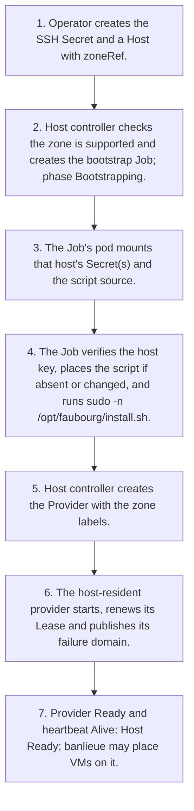

# Architecture Flows

!!! note "Auto-generated"

    Rendered from `docs/architecture/calm/architecture.json` by the CALM
    CLI (`calm template`). **Do not edit this file by hand** , edit the
    architecture JSON or the Handlebars template at
    `docs/architecture/calm/templates/mermaid/flows.md.hbs` and regenerate
    with `make calm-diagrams`.

Each flow defined in the CALM architecture is rendered below as its own
Mermaid `flowchart TD`, one diagram per flow, linking the transitions in
sequence order.

## Add a host to a zone

From a new Host object to a host banlieue can place VMs on.

Source: flow `flow-add-host` in `architecture.json`.

