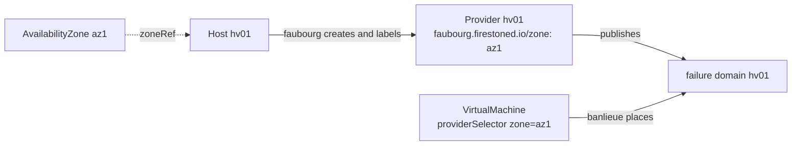
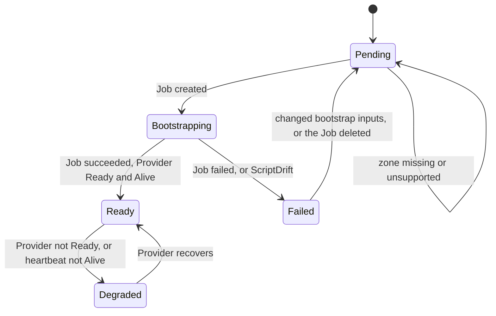

<!-- Copyright (c) 2026 Erick Bourgeois, faubourg -->
<!-- SPDX-License-Identifier: Apache-2.0 -->

# Concepts

## Two objects

faubourg has two cluster-scoped custom resources in the group `faubourg.firestoned.io/v1alpha1`
([ADR-0003](adr/0003-availabilityzone-and-host-crds.md)). They are cluster-scoped like `Node`:
a hypervisor belongs to the platform, not to a tenant namespace.

`AvailabilityZone` (short name `az`)
:   A failure domain and a shared-fate boundary for storage and network: a rack, a room, a
    power feed. It sets the zone's storage model and, optionally, extra labels for every member
    host's banlieue `Provider`.

`Host`
:   One physical machine that runs Cloud Hypervisor. It names its zone, the address the
    bootstrap Job reaches over SSH, the Secrets that hold its credentials, and how it is
    bootstrapped.

The field-by-field reference is in [API](reference/api.md).

## How a zone reaches banlieue's scheduler

banlieue's scheduler already selects providers by label and spreads VMs across failure
domains. Each Cloud Hypervisor `Provider` publishes one failure domain, carrying the
`Provider`'s own labels. So faubourg needs no scheduler of its own. It puts the zone on each
host's `Provider` as a label:

faubourg owns exactly these labels on the `Provider`, under its own field manager:

| Label | Value |
| --- | --- |
| `faubourg.firestoned.io/zone` | the zone name |
| `faubourg.firestoned.io/host` | the Host name |
| `faubourg.firestoned.io/cordoned` | `"true"` while the host is cordoned |
| each key of the zone's `providerLabels` | its value |

A zone's `providerLabels` may not use the `faubourg.firestoned.io/` prefix, so a zone cannot
move a host into another zone by overwriting the zone label.

The labels are applied under `faubourg.firestoned.io/host-controller`. For a bootstrapped host,
faubourg also sets the Provider's class and endpoint, under a second field manager,
`faubourg.firestoned.io/host-provider-spec`. A host switched back to `bootstrap.method: None`
keeps that spec as faubourg last set it; faubourg only stops writing it.

## Lifecycle of a host

A `Host` moves through five phases ([ADR-0007](adr/0007-health-from-the-banlieue-provider.md)):

- **Pending:** accepted, nothing started. No Job is created while the Host's zone is missing
  or unsupported.
- **Bootstrapping:** the per-host Job is running.
- **Ready:** the Job succeeded *and* the host's `Provider` is `Ready=True` with a heartbeat of
  `Alive`. Success is the provider coming up, not an exit code.
- **Degraded:** was ready, and the `Provider` stopped being ready or its heartbeat went
  `Stale` or `Absent`. faubourg never deletes a `Provider` because of this, since banlieue
  already stops placing on a stale provider.
- **Failed:** the Job failed, or the spec was refused by validation.

A host with `bootstrap.method: None` is adopted: it already runs banlieue's provider, so there
is no Job and no SSH, and it goes straight from Pending to whatever its `Provider` says.

## Zone health

An `AvailabilityZone` publishes `hosts`, `readyHosts`, and `Ready=True` when at least one member
host is `Ready` and its storage mode is supported.

## Storage: local only in v1

Every v1 zone is `storage.mode: Local` ([ADR-0004](adr/0004-v1-local-storage-only.md)). A VM's
disks live on its host, so:

- there is no live migration and no fencing;
- losing a host loses the VMs on it, and recovery means recreating them from a pool or image
  on a healthy host, which banlieue already does for pool members.

`Shared` is in the schema so the API will not break when it arrives, but faubourg refuses it
today: the zone is `Ready=False` with reason `StorageModeUnsupported`.

## Cordon

`spec.cordoned: true` on a Host labels its `Provider` `faubourg.firestoned.io/cordoned: "true"`.
banlieue does not yet exclude cordoned providers from placement, so for now a cordon is
advisory and the Host's condition says so (accepted risk R-4 in the
[threat model](security/threat-model.md)).

## The vCenter analogy

| vCenter | Here |
| --- | --- |
| ESXi host agent (`hostd`) | banlieue's host-resident Cloud Hypervisor provider |
| DRS placement | banlieue's scheduler |
| Cluster | `AvailabilityZone` |
| "Add host" | `Host` and its bootstrap Job |
| Inventory | faubourg's `Host` list |

The analogy stops at storage: v1 has no vMotion and no HA restart, by design.
