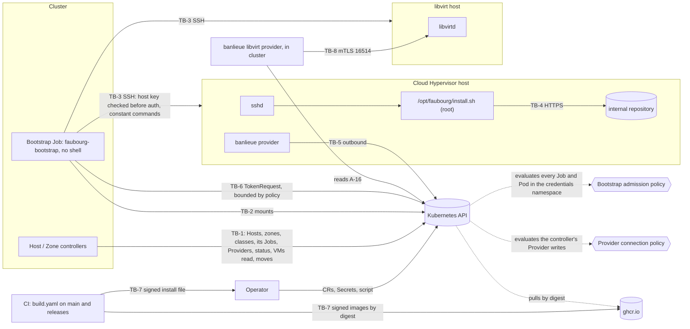

<!--
Copyright (c) 2026 Erick Bourgeois, faubourg
SPDX-License-Identifier: Apache-2.0
-->
# Threat Model

> **Status:** Living document. Last full pass **2026-11-19**, against the architecture
> defined by **ADR-0001 … ADR-0018** (all Accepted;
> ADR-0002, ADR-0005, ADR-0007, ADR-0008, ADR-0009, ADR-0010 and ADR-0011 amended, ADR-0009
> decision 1 superseded by ADR-0014, ADR-0003 amended after banlieue ADR-0124, ADR-0011 amended
> by ADR-0016 and after banlieue ADR-0126, ADR-0004 and ADR-0015 amended by ADR-0017,
> ADR-0002, ADR-0003, ADR-0005, ADR-0007, ADR-0011 and ADR-0017 amended by ADR-0018).
> Nineteenth pass, for the ADR-0018 amendment after the first live libvirt test: banlieue's own
> credentialsRef policy refuses faubourg's writes of a Provider that names a credential, since
> faubourg's controller reads no Secret; such a refusal now fails the Host with
> `ProviderApplyRefused`, and `controller-test` installs banlieue's policy. libvirt zones wait
> for banlieue ADR-0157. One TB-1 row, R-17 rewritten; no new grant or boundary.
> Eighteenth pass, for ADR-0018 as built in roadmap 04 phases B and C: a zone names its
> banlieue ProviderClass, whose backend picks a driver from a closed set (`cloud-hypervisor`,
> and `libvirt`); Firecracker is refused until banlieue ships it. A libvirt host runs no banlieue
> process: banlieue's provider runs in the cluster and dials libvirtd over mutual TLS on 16514
> with one client credential per zone, which faubourg names on the Provider and never reads,
> bounded by a new admission policy, `faubourg-provider-connection`. A libvirt Host's bootstrap
> mints nothing, its health is `ProviderReachable`, not a pod's Lease, and its drain moves
> nothing. Two Hosts at one literal address are refused. Three components, A-16 and A-17, A-5,
> A-9 and two actors widened, TB-8 and the diagram, ten TB-1 rows (one rewritten), one TB-3
> row, R-16 to R-18. Seventeenth pass, for ADR-0017 decisions 2 to 7: `Host.spec.maintenance: Drain` cordons the
> host and creates one banlieue `VirtualMachineMove` at a time for the VMs scheduled on it,
> reporting `Drained`; clearing it deletes the moves not yet handing over. The controller gains
> a cluster-wide read of banlieue `VirtualMachine`s and create, list and delete on
> `VirtualMachineMove`s, and nothing more (no write to a VM, no change to a move). One
> component, A-14 and A-15, A-9 widened, the TB-1 edge in the diagram, six TB-1 rows and R-15.
> banlieue's mover is not shipped (its ADR-0127 Stage 1), so today a move is a request nothing
> acts on. Sixteenth pass, for ADR-0017 decision 1 on banlieue v0.5.7: every member host's Provider
> carries `banlieue.io/zone`, by the existing field manager, only while the Host's zone exists
> and is valid. The key is faubourg's statement that the zone's hosts share their L2 segments,
> on which banlieue will admit VM moves (banlieue ADR-0127; nothing in banlieue acts on it yet).
> Two TB-1 rows, R-7 widened, R-14 added (a deleted Host's Provider keeps the key); no new
> component, identity, grant or boundary.
> Fifteenth pass, for ADR-0017: the zone's advisory `HostsMatch` condition, which reads the
> members' Providers the controller already read. Fourteenth pass: faubourg reads the provider's
> ServiceAccount name from banlieue instead of deriving it, which closes R-10 and roadmap 01.
> The thirteenth pinned the CA hosts trust for the API server (ADR-0016). The twelfth closed R-4 (a cordon reaches banlieue's scheduler). The
> eleventh added the zone controller (ADR-0015), the tenth leader election (ADR-0014), the
> ninth pinned the install script's content (ADR-0013), the eighth closed R-3.
> The shipped code is `crates/faubourg-api` (types, validation, the SSH
> Secret contract, the Job-to-image contract), `crates/faubourg-controller` (the Host
> reconciler and its binary) and `crates/faubourg-bootstrap` (the bootstrap image's binary, on
> russh), with the admission policy, the RBAC and the controller Deployment in `deploy/` and
> both images in `images/`. The policy (`make vap-test`), the controller with its own RBAC
> (`make controller-test`), the image against a real OpenSSH host (`make bootstrap-test`) and a
> bootstrap end to end on kind from the rendered install file (`make e2e-test`; banlieue
> simulated) run in CI. v0.1.0 and v0.1.1 are released, signed and verified as the installing
> guide says. On a real k0s cluster with a real banlieue, faubourg adopted a live Cloud
> Hypervisor host, then bootstrapped it from nothing over its own sshd with a pinned host key:
> placement created the scoped account, placed the script and the sudo rule and revoked its own
> key, and the host's provider came up on the token the bootstrap pod minted. The live tests
> found three bugs, each fixed with a test that reproduces it (ADR-0010 and ADR-0011 amended,
> the example script's `--provider-binary`) and one new accepted risk (R-13). Every control
> below exists and is cited; no component is planned.

## 1. What faubourg is, in security terms

faubourg groups bare-metal hosts into availability zones and bootstraps new hosts for banlieue.
A zone's banlieue ProviderClass decides how its hosts are driven: Cloud Hypervisor, whose
provider runs on the host, or libvirt, whose provider runs in the cluster (ADR-0018). Its security weight comes from two facts:

- It holds, or arranges access to, a **root-equivalent path onto every hypervisor**: the
  SSH credentials and the install script that runs as root.
- It decides **which hosts banlieue may place VMs on**, through the labels and existence of
  each host's banlieue `Provider`.

It runs no agent on the hosts and no VM scheduler (ADR-0002). After bootstrap, the only
management path to a Cloud Hypervisor host is banlieue's host-resident provider, outbound only.
To a libvirt host it is banlieue's in-cluster provider, inbound to libvirtd over mutual TLS
(TB-8), with a client credential an operator made for the zone.

## 2. Components

| Component | State | Where |
| --- | --- | --- |
| `faubourg-api` types, validation, Secret contract | shipped | `crates/faubourg-api` |
| CRDs | shipped | `deploy/crds/` (generated, drift-tested) |
| Default install script and sudoers rule | shipped as examples; run on a live host | `examples/host/` |
| Host phase machine and `Provider` health | shipped, pure functions, no cluster access | `crates/faubourg-controller/src/{phase,health}.rs` |
| Bootstrap Job builder | shipped, pure function | `crates/faubourg-controller/src/job.rs` |
| Bootstrap admission policy (ADR-0008) | shipped as manifests, tested on kind | `deploy/admission/`, `scripts/vap-test.sh` |
| Controller and bootstrap identities, RBAC | shipped as manifests, tested on kind | `deploy/rbac/controller.yaml` |
| Host controller (reconciler, binary) | shipped, tested on kind with its own RBAC; released (ADR-0012) and run on a live cluster | `crates/faubourg-controller/src/{plan,controller,config,main}.rs`, `deploy/controller/`, `scripts/controller-test.sh` |
| Creating and labelling Providers (ADR-0011) | shipped, tested on kind | `crates/faubourg-controller/src/provider.rs`, `scripts/controller-test.sh`, `scripts/e2e-test.sh` |
| Provider token minting and the `faubourg-provider-tokens` policy (ADR-0011) | shipped, tested on kind | `crates/faubourg-bootstrap/src/provider.rs`, `deploy/admission/bootstrap-policy.yaml`, `scripts/vap-test.sh` |
| Bootstrap image (SSH client) | shipped, tested against OpenSSH; released (ADR-0012) and run against a live host | `crates/faubourg-bootstrap`, `images/bootstrap/Containerfile`, `scripts/bootstrap-test.sh` |
| Image publication and the install file (ADR-0012) | shipped in CI; v0.1.0 and v0.1.1 released and verified | `.github/workflows/build.yaml` (`images`, `release-manifests`), `images/`, `scripts/render-manifests.sh` |
| Leader election (ADR-0014) | shipped, tested on kind with two controllers | `crates/faubourg-controller/src/{leader,main}.rs`, `deploy/rbac/controller.yaml`, `deploy/controller/deployment.yaml` |
| Script pinning and the rollout (ADR-0013) | shipped, tested on kind and against OpenSSH | `crates/faubourg-api/src/policy.rs`, `crates/faubourg-controller/src/{plan,job}.rs`, `crates/faubourg-bootstrap/src/config.rs`, `deploy/admission/bootstrap-policy.yaml` |
| Zone controller (ADR-0015) | shipped, tested on kind | `crates/faubourg-controller/src/{zone,controller}.rs` |
| Host drain (ADR-0017) | shipped, tested on kind with banlieue's CRDs and its own RBAC; banlieue's mover not shipped | `crates/faubourg-controller/src/{drain,plan,controller,provider}.rs`, `deploy/rbac/controller.yaml`, `scripts/controller-test.sh` |
| Backend drivers: a zone's class, `cloud-hypervisor` and `libvirt` (ADR-0018) | shipped, tested on kind; `firecracker` refused | `crates/faubourg-controller/src/{backend,plan,health,job,provider,zone,drain}.rs`, `crates/faubourg-api/src/zone.rs`, `scripts/controller-test.sh` |
| Provider connection admission policy (ADR-0018 decision 6) | shipped as a manifest, tested on kind | `deploy/admission/provider-connection-policy.yaml`, `scripts/vap-test.sh` |
| Example libvirt install script | shipped as an example; shellcheck-clean, not yet run on a live host (R-17) | `examples/host/install-libvirt.sh` |

## 3. Assets

| Asset | Why it matters |
| --- | --- |
| A-1 Placement credential (`ssh.placementSecretRef`) | Privileged on the host: writes `/opt/faubourg` and `/etc/sudoers.d`. Root-equivalent. |
| A-2 Scoped run credential (`ssh.secretRef`) | Can run exactly one root-owned script, as the host account placement creates for it (ADR-0010, amended). |
| A-3 Install script source (ConfigMap or Secret) | Runs as root on every host whose copy is updated, once A-8 pins its content. Root-equivalent across the fleet, with A-8. |
| A-4 `/opt/faubourg/install.sh` on the host | Root runs it under the sudo rule. |
| A-5 Host and AvailabilityZone CRs | Decide what gets bootstrapped and where VMs may land. A zone also names the ProviderClass that drives its hosts and, for libvirt, which client credential and CA (A-16) banlieue's provider uses for them (ADR-0018). |
| A-6 Each host's banlieue `Provider` labels | banlieue places by them (ADR-0003), and `faubourg.firestoned.io/host` decides which Provider's health is the host's (ADR-0009 decision 5). |
| A-7 Pinned banlieue digest (the sha256 of the binary, or of banlieue's release tarball) | The script's only proof the binary is genuine. |
| A-8 Bootstrap policy parameters (`faubourg-bootstrap-policy` in `faubourg-system`) | Name the only image that may mount A-1 and A-2, the only scripts that may run (each A-3 source and key with the sha256 of its content, ADR-0013), and optionally the CA every host trusts for the API server, pinned the same way (ADR-0016). Root-equivalent across the fleet. The controller reads it; nothing in it is secret. |
| A-9 The controller's ServiceAccount token | Creates and deletes Jobs in the credentials namespace, writes Host status and reads A-8. Since ADR-0017 it also reads every VM (A-14) and creates and deletes moves in any namespace (A-15). Since ADR-0018 it reads ProviderClasses and writes a libvirt Provider's connection, which names A-16 for banlieue's workload to read, bounded by `faubourg-provider-connection`. Cannot read a credential or a script (ADR-0008, ADR-0013), but can run the pinned image with any credential and a pinned script (R-5). |
| A-10 The host's provider token | Authenticates as the host Provider's ServiceAccount for a day: reports that Provider's status and serves its machines. Minted by the bootstrap pod, held only by the host (ADR-0011). |
| A-11 The bootstrap pods' projected token | `faubourg-bootstrap` for 600 seconds: mints A-10 for provider ServiceAccounts of one class. |
| A-12 The published images and the install file | The bootstrap image is the fleet's root of trust; the install file decides which digest the admission policy admits (ADR-0012). |
| A-13 The leader Lease (`faubourg-controller` in `faubourg-system`) | Its holder is the one replica that acts. Whoever can write it can stop every replica from acting, or hold it for a replica that does nothing. |
| A-14 banlieue `VirtualMachine`s, read cluster-wide | Names, namespaces and placements of every VM; specs name Secrets (never their contents). faubourg reads them to find a draining host's VMs and logs only the namespace and name of a VM it asks to move. |
| A-16 A libvirt zone's client credential (a `faubourg-` Secret in banlieue's namespace, `tls.crt` and `tls.key`) and its CA (a `faubourg-` ConfigMap) | The key is the only credential libvirtd asks for (`auth_tls "none"`): whoever holds it drives libvirtd on every host of the zone, which is root-equivalent there. One per zone (ADR-0018 decision 6). Made by an operator; read only by banlieue's libvirt provider, under the Role banlieue's operator gives it; never by faubourg. |
| A-17 A libvirt host's libvirtd server key and certificate | Prove the host to banlieue's provider against A-16's CA. Per host, from the operator's PKI; faubourg neither makes nor carries them. |
| A-15 The `VirtualMachineMove`s faubourg creates | Each asks banlieue to move a running guest, memory and disk, to another host of its zone. One too many pauses a guest; one cancelled at the wrong time would be a split brain, which banlieue prevents by refusing to cancel after `HandingOver`. |

## 4. Actors

| Actor | Trust |
| --- | --- |
| Platform administrator | Trusted. Writes the admission policy, its parameters (A-8), the RBAC and the Secrets, and pins each script change (ADR-0013). |
| Platform operator | Trusted for inventory. Writes Host and AvailabilityZone CRs; `maintenance: Drain` on a Host asks banlieue to move every VM on it. A zone's class and its libvirt references are names: the operator decides which `faubourg-` credential a zone's hosts use, never what is in it. |
| Script maintainer | Trusted for A-3 only. Writes ConfigMaps in the credentials namespace; cannot change which image runs, which objects may be a script, or which content runs: A-8, which pins it, lives elsewhere. |
| The Host controller | Not trusted with credentials. A compromise must not yield a key (ADR-0008). |
| banlieue administrator | Trusted by banlieue. Writes Providers and their labels in banlieue's namespace, so can attach a Provider to a Host by label (R-7). Writes ProviderClasses, whose `backend` and `deployment` decide which faubourg driver a zone gets. Makes A-16 for a libvirt zone. |
| banlieue's libvirt provider (in the cluster) | Trusted by banlieue with A-16. Dials each libvirt host's libvirtd (TB-8). |
| VM consumer | Untrusted toward faubourg. Never reads or writes faubourg objects. |
| Cluster workloads | Untrusted. Must not read the credentials namespace or the script source. |
| Network attacker between cluster and hosts | Untrusted. |
| A compromised host | Untrusted toward the cluster and toward other hosts. |
| The internal artifact repository | Trusted for availability, not integrity: the digest decides. |

## 5. Trust boundaries

- **TB-1** controllers → Kubernetes API: Hosts, zones, the Jobs and pods in the credentials
  namespace, Providers in banlieue's namespace, and (ADR-0017) banlieue VMs, read, and the moves
  it creates, in every namespace.
- **TB-2** Job pod → its mounted Secret(s) and script source.
- **TB-3** Job → host sshd (placement and run).
- **TB-4** install script → artifact repository (curl).
- **TB-5** banlieue provider → Kubernetes API (banlieue's boundary; see its threat model).
- **TB-6** bootstrap pod → Kubernetes API: TokenRequest for the host's provider (ADR-0011).
- **TB-7** this repository's CI → the registry and the release → the operator's cluster: how an
  image and the install file come to be trusted (ADR-0012).
- **TB-8** banlieue's in-cluster libvirt provider → a libvirt host's libvirtd, mutual TLS on
  16514 (ADR-0018). The provider is banlieue's; faubourg decides only which `faubourg-`
  credential and CA it is pointed at, and prepares the host's side with its install script.

## 6. STRIDE, per boundary

### TB-1: controllers → Kubernetes API

| Threat | STRIDE | Control |
| --- | --- | --- |
| Controller reads SSH Secrets and leaks them | I | The controller's RBAC has no verb on Secrets anywhere, none on ConfigMaps but `get`, `list` and `watch` on A-8 by name, and no Pod create or subresource (`deploy/rbac/controller.yaml`; `vap-test` checks each with `auth can-i`, including that it cannot read the script, another ConfigMap in `faubourg-system`, or list them). |
| A script edited in place reaches hosts, unreviewed | T, E | It runs nowhere until the platform administrator pins its sha256 in A-8 (ADR-0013). The admission policy admits a Job only if its script volume's source, its one key and its `FAUBOURG_SCRIPT_SHA256` match a pinned entry, and every entry must be pinned (`deploy/admission/bootstrap-policy.yaml`; `vap-test`: another digest, no digest, another key, two keys, the whole source, a policy with an unpinned entry). The image hashes the mounted script before any connection and exits 66 on a mismatch (TB-2). |
| A compromised controller has the pinned digest checked and another one used | T, E | The policy accepts exactly one `FAUBOURG_SCRIPT_SHA256`: with two, the container would see the last (`vap-test`: "a second digest after the pinned one"). |
| A re-pin runs new root code on the whole fleet at once, or keeps going after it breaks a host | T, D | A Host that has bootstrapped before waits for a slot: at most `--max-rebootstraps` (default 1) re-bootstrap Jobs at once, and none starts while another Host's re-bootstrap has failed. The controller reconciles one Host at a time so the count is exact (`plan.rs`, `rollout`, `a_rebootstrap_waits_for_a_slot_and_keeps_its_phase`, `a_failed_rebootstrap_halts_the_rollout`; `controller.rs`, `concurrency(1)`, and every re-bootstrap Job event wakes every Host, so a held one sees a slot free or the halt at once (`only_a_rebootstrap_job_wakes_every_host`); `controller-test`: "one re-bootstrap starts", "a failed re-bootstrap halts the rollout"). |
| A forged re-bootstrap Job halts the rollout | D | Creating a Job in the credentials namespace already takes a trusted role, and a halt fails closed: nothing runs until the Job is deleted. |
| A Host's status is edited so its re-bootstrap skips the rollout | T | Of faubourg's identities only the controller writes `hosts/status` (`deploy/rbac/controller.yaml`); anyone else who can is a cluster administrator. A forged `bootstrappedInputs` changes when a Host runs, never what: the script is still the pinned one. |
| Compromised controller creates a Job that prints a key (its own image, a command, `envFrom`, an extra volume, a mounted token, a host namespace) | I, E | ADR-0008: every Job in the credentials namespace must run the digest-pinned image from A-8 with no command or arguments, literal env, only the `credentials`, `placement` and `script` volumes read-only, the bootstrap ServiceAccount with no token, no host namespaces and the restricted profile (`deploy/admission/bootstrap-policy.yaml`, `faubourg-bootstrap-jobs`). Applies to cluster-admin too. Each rule has a refusing case in `scripts/vap-test.sh`. |
| Compromised controller mounts another host's key as the "install script", so placement copies it to a host it chooses | I | The `script` volume must be on A-8's `scriptSources` allowlist (`vap-test`: "another host's key as the script"). |
| A Secret reaches a pod by another route: a direct Pod, a Deployment, an ephemeral container, `kubectl set image` | I, E | `faubourg-bootstrap-pods`: only `system:serviceaccount:kube-system:job-controller` creates Pods there, for a Job it controls; Pod specs never change; no ephemeral containers (`vap-test`, including a real Job's pod). |
| The policy parameters are changed to admit another image | T, E | A-8 lives in `faubourg-system`; the controller has no ConfigMap write anywhere, and a script maintainer's ConfigMap access is in the credentials namespace (`vap-test`: "change the policy parameters: no"). Missing parameters deny every Job (`parameterNotFoundAction: Deny`, tested). |
| The policy fails open on an error | T | `failurePolicy: Fail` on both policies. Observed: a CEL error in an early draft denied every pod, the Job controller's included. |
| The controller's own Job fails the policy, so bootstrap never works | D | The builder's real output is the first case `vap-test` submits (`examples/bootstrap-job.rs`); the builder's shape is also unit-tested rule by rule (`job.rs`). |
| A Host CR smuggles a shell command into the bootstrap | T, E | The Host API carries no free-form argument: `bootstrap` is a method and a script reference only (`crates/faubourg-api/src/host.rs`, `BootstrapSpec`). Address, names and keys are validated fail closed (`HostSpec::validate`). |
| An address is read as an SSH option (`-oProxyCommand=...`) | E | `is_address` accepts only an IP or a lowercase DNS name, which cannot begin with `-` (`host.rs`, tested by `addresses_that_could_be_ssh_options_or_shell_are_refused`). |
| A zone's `providerLabels` overwrites faubourg's own label and moves hosts between zones | T | Keys under `faubourg.firestoned.io/` are refused (`zone.rs`, `REASON_RESERVED_LABEL`). |
| A zone's `providerLabels` cordons every member through banlieue, outside any Host's `cordoned` | T, D | `banlieue.io/unschedulable` is reserved too (`zone.rs`, `provider_labels_may_not_cordon_a_zone_through_banlieue`). faubourg's copy of the key is checked against banlieue-api's (`provider.rs`, `faubourgs_copy_of_banlieues_cordon_label_matches_banlieue`). |
| A zone's `providerLabels` puts its members in **another banlieue zone**, so banlieue would move VMs between hosts that do not share their L2 segments and a moved guest's addresses break (ADR-0017 decision 1) | T, D | `banlieue.io/zone` is reserved (`faubourg-api` `zone.rs`, `provider_labels_may_not_put_a_zone_in_another_banlieue_zone`); faubourg's copy of the key is checked against banlieue-api's (`provider.rs`, `faubourgs_copy_of_banlieues_zone_label_matches_banlieue`). |
| `banlieue.io/zone` is stated for a Host whose zone is **missing, refused (`Shared`) or another zone**, so banlieue treats an unvetted host as a zone member | T | Fail closed: the key is written only when the zone object is the one the Host names and passes validation, and server-side apply removes it otherwise (`provider.rs`, `labels`; `banlieues_zone_label_needs_a_zone_that_exists_and_is_valid`); `controller-test` checks it set, following a Host to another zone, and gone for a `Shared` and a missing zone. |
| A compromised controller asks banlieue to **move any VM** in the cluster, or many at once | T, D | Bounded, not prevented: the controller can create and delete moves but never write a VM (`deploy/rbac/controller.yaml`; `controller-test` checks `patch`, `update` and `delete` on a VM and `patch` on a move are refused). A move names no target, so where a VM goes is banlieue's, inside the VM's zone. R-15. |
| The drain **deletes a VM**, or retries a refused move in a loop | D | It never does either: no `delete` on VMs (RBAC, `controller-test`); a `Rejected` or `Failed` move blocks its VM and is not asked again (`drain.rs`, `a_rejected_or_failed_move_blocks_its_vm_and_never_retries`; `controller-test`). |
| A drain reports done, or proceeds, when the cluster serves **no move API** | T | Fails closed: a 404 listing VMs or moves is "not served", never "empty" (`controller.rs`, `list_or_unserved`), and the drain creates nothing and reports `MovesUnsupported` (`drain.rs`, `no_move_api_creates_nothing_and_says_so`). |
| Ending a drain **cancels a move mid-handover**, leaving the guest on both hosts or neither | T, D | Only `Pending`, `Preparing` and `Copying` moves are deleted, by banlieue-api's `MovePhase::is_cancellable` (`drain.rs`, `clearing_maintenance_cancels_only_moves_before_handover`; `controller-test`). |
| A drain floods banlieue: every VM of a host moving at once | D | One move in flight per host (`MAX_MOVES_PER_HOST`; `a_drain_asks_for_one_move_at_a_time`, `a_move_in_flight_holds_the_next_one`; `controller-test` "one move at a time"). A host that is not `Ready` gets none (`a_host_that_is_not_ready_is_not_drained`). |
| Someone's own move, carrying the Host label, is **cancelled** when faubourg ends a drain | T | Bounded: the label is under faubourg's prefix and faubourg deletes only moves that carry it; whoever can label a move can delete it anyway. |
| An unsupported storage mode is silently treated as Local | T | `Shared` is refused (`zone.rs`, `shared_storage_is_refused_in_v1`). |
| A Host is reported `Ready` (and its zone counted ready) when its provider is not running | S, T | The phase machine reaches `Ready` only from `ProviderHealth::Healthy` (`crates/faubourg-controller/src/phase.rs`, `nothing_reaches_ready_without_a_healthy_provider`). Healthy needs `Ready=True` for the `Provider`'s current generation **and** an `Alive` heartbeat; a missing, `Unknown`, stale-generation or not-yet-evaluated signal is unhealthy (`health.rs`). A refused spec is `Failed` whatever the cluster says (`a_refused_spec_fails_whatever_the_cluster_says`). |
| A Job someone else made, with the Host's labels, is taken as the Host's (a forged `Complete` record, or a squatter) | S, T | Only a Job whose controller `ownerReference` carries the Host's UID counts (`job.rs`, `owned_by`, `only_the_hosts_own_jobs_are_its_jobs`); a recreated Host does not inherit the old one's Jobs (`plan.rs`, `a_job_of_a_recreated_host_is_not_its_own`). |
| The controller deletes a Job it does not own | T, D | Only owned Jobs are ever deleted (`plan.rs`, `a_job_the_host_does_not_own_is_ignored_and_never_deleted`). |
| A Job squats the name of a Host's next Job, so bootstrap never starts | D | The create fails with `AlreadyExists`, which the controller logs and retries (`controller.rs`, `JobNameTaken`); it never adopts that Job. Creating a Job there already needs a role trusted with the namespace. |
| Cordoning a host, moving it to another zone, or upgrading the controller re-runs root's install on it | T | A new Job only when the bootstrap inputs change: `address`, `ssh`, the resolved script source and its pinned digest, hashed into the Job's annotation; `zoneRef`, `cordoned` and the image are not inputs (`job.rs`, `cordon_zone_and_image_are_not_bootstrap_inputs`, `the_pinned_digest_is_an_input_and_in_the_environment`, `the_inputs_encoding_is_pinned`; `controller-test`: "no new Job after a cordon"). The upgrade to ADR-0013 changes the encoding once, so each bootstrapped host re-runs once, through the rollout: a Host's last succeeded Job is kept until its status, as read back, records that success, so the re-run is held like any re-bootstrap (`plan.rs`, `the_last_success_is_kept_until_the_status_records_it`; found on the first live upgrade, where the record was not yet in the controller's cache and one host re-ran outside the rollout). |
| A failed bootstrap is retried in a loop against a host (a wrong key, a refused host key) | D | The controller never replaces a failed current Job; the Host stays `Failed` until its inputs change or an operator deletes the Job (`plan.rs`, `a_failed_job_is_kept_and_not_retried`). |
| A Host bootstraps into a missing or `Shared` zone | T | No Job until the zone exists and validates (`phase.rs`, `a_missing_zone_holds_a_host_that_has_not_started`; `controller-test`). |
| A Host name longer than a label value is truncated into another host's label | T | The CRD refuses names over 63 characters (CEL rule in `deploy/crds/faubourg.firestoned.io_hosts.yaml`; `controller-test`), and the builder refuses them too. |
| The controller starts with an image by tag, or with a malformed namespace or script source | T | It refuses to start (`config.rs`, `the_image_is_required_and_must_be_pinned`, `a_malformed_default_script_is_refused`; `controller-test`: "the controller refuses an image by tag"). An image other than A-8's is refused by the API server anyway. |
| Two controller instances race and write conflicting state, or exceed the rollout's limit | T | Two replicas, of which only the holder of the Lease acts (ADR-0014). Acquiring and taking over are conditional writes, so of two candidates one wins (`leader.rs`, `claim`, `a_claim_is_conditional_and_counts_a_change_of_hands`), and the leader stops if it has not renewed within 10 seconds, before its 15-second lease can lapse, so a standby takes over only after it stopped (`hold`, `the_leader_stops_before_its_lease_can_run_out`; `controller-test`: "the second waits to lead", "and does nothing else", "the standby takes over"). This holds while clock skew between nodes stays under 5 seconds. Every write is idempotent too: Jobs by a name derived from the Host, status by server-side apply under `faubourg.firestoned.io/host-controller` (a bootstrapped host's Provider spec under `faubourg.firestoned.io/host-provider-spec`). |
| A partitioned or paused leader keeps acting after a standby took over | T | It exits when no renewal has succeeded within the deadline, and each renewal is cut off at the deadline, so a hung API call cannot hold it past it (`leader.rs`, `hold`). A leader that loses the Lease to another holder stops at once (`main.rs`). |
| The controller's Lease is held or deleted to stop every replica | D | Writing it takes `update` on that Lease or `create` in `faubourg-system`, which only the controller and a cluster administrator hold; the controller cannot delete it (`deploy/rbac/controller.yaml`; `vap-test`: "delete the leader Lease: no", "write another Lease: no", "create a Lease elsewhere: no"). A replica that cannot lead waits; nothing on the hosts depends on it. |
| A replica starts with no identity, or with another's, and takes the Lease as its own | S, T | It refuses to start without `POD_NAME` from the downward API, and never guesses one (`config.rs`, `the_controller_needs_a_well_formed_identity_to_elect`; `controller-test`). Pod names are unique in a namespace. |
| A zone's status is forged or stale, and an operator places VMs on a zone that cannot take them | S, T | Of faubourg's identities only the controller writes `availabilityzones/status`, under its own field manager (`deploy/rbac/controller.yaml`, `zone.rs`, `FIELD_MANAGER`); anyone else who can is a cluster administrator. The status is a report: nothing faubourg decides reads it (ADR-0015 decision 6), and banlieue places by Provider labels, not by it. A stale count lasts at most until the next Host event or resync. |
| The zone controller writes more than a zone's status | T | It applies status only, and `controller-test` checks every entry of its field manager is on the `status` subresource ("the zone controller writes status only"). |
| A zone reports `HostsMatch` from a Provider that is not its member's (another zone's host, an unlabelled one, or one of two claiming a host), and an operator drains into a host that cannot take the VM | S, T | Only the one Provider labelled with a member Host counts; two for one host are `HostsUnreported`, never a match (`zone.rs`, `report`; `providers_of_other_zones_hosts_are_ignored`, `two_providers_claiming_one_host_are_unreported`). The condition is advisory: nothing faubourg decides reads it, and banlieue admits or refuses every move on its own check (banlieue ADR-0127 decision 3). A forged Provider status is banlieue's boundary (row below). |
| A zone's status discloses its hosts' VMM build and CPU model | I | Already in each Provider's status, readable by whoever reads Providers; the zone copies only the most common pair and the names of the hosts that differ, bounded to ten (`zone.rs`, `named`, `the_named_hosts_are_bounded`). No address, credential or Secret value. |
| A zone reports Ready while every usable host is cordoned, or counts a host from another zone | T | `Ready` needs a member that is `Ready` and not cordoned; membership is the Host's `zoneRef` alone (`zone.rs`, `a_zone_whose_ready_hosts_are_all_cordoned_is_not_ready`, `a_zone_with_no_hosts_is_not_ready`; `controller-test`: "a host moving out empties its old zone"). |
| A deleted Host leaves a Job running with its credentials mounted | I | Jobs are owned by their Host and garbage collected with it (`controller-test`: "the Job is garbage collected"). |
| The controller reads more of banlieue's namespace than Providers | I | A Role there grants `get`, `list`, `watch`, `create`, `patch` on `providers.banlieue.io` only: no delete, no Secret, no `serviceaccounts/token` (`deploy/rbac/controller.yaml`; `vap-test` checks each). |
| faubourg overwrites an adopted host's Provider, or deletes one | T, D | An adopted host's Provider gets labels only, by server-side apply, never its spec (`provider.rs`, `every_host_gets_labels_and_nothing_else_under_the_labels_manager`, `spec_body`; `controller-test` checks faubourg owns no spec field). The one exception moves a spec a v0.1 controller left under the labels' manager to the spec manager, with its values unchanged (`provider.rs`, `migrated_spec_body`, `nothing_moves_unless_the_labels_manager_owns_the_spec`). faubourg holds no delete on Providers and sets no ownerReference, so deleting a Host keeps its Provider (`controller-test`, `e2e-test`). |
| A Host switched from `Script` to `None` loses its Provider's spec, or can no longer be labelled (so a cordon never reaches banlieue) | D, T | The spec and the labels have separate field managers, the spec applied first and only for `Script`, so the labels' apply never leaves a spec field without a manager; the spec stays as faubourg last set it (ADR-0011, amended; `plan.rs`, `a_host_switched_to_none_stops_writing_the_spec_and_keeps_labelling`; `controller-test`: "switched to None, its Provider is still labelled", "a v0.1-owned Provider of an adopted Host is still labelled"). |
| A zone's class is driven as the wrong kind of provider: a Managed `cloud-hypervisor`, an `External` `libvirt`, a backend faubourg has no driver for (`firecracker` until banlieue ships it, `vsphere`), or a class that does not exist | T | The driver comes from a closed set by `spec.backend`, and the class's `deployment` must be that driver's; anything else is `ProviderBackendUnsupported` on the zone and on every member, bootstrapped and adopted alike, with no Provider written and no Job (`backend.rs`, `Backend::of`, `a_backend_without_a_driver_is_refused`, `a_cloud_hypervisor_class_in_the_wrong_mode_is_refused`; `plan.rs`, `a_class_faubourg_cannot_drive_fails_the_host_and_creates_nothing`; `zone.rs`, `a_zone_whose_class_faubourg_cannot_drive_is_not_ready`; `controller-test`). A change to any ProviderClass re-decides every Host and zone (`controller.rs`). |
| A compromised controller points a libvirt Provider at **another Provider's credential**, or banlieue's own, so banlieue's operator grants the libvirt workload `get` on it and that workload presents it to an endpoint the controller chose | I, E | `faubourg-provider-connection`: a Provider create or update by the controller's ServiceAccount that changes the connection is admitted only with a `credentialsRef` named `faubourg-...`, a CA only from a `faubourg-...` ConfigMap (never inline, never a Secret), and never `insecureSkipTLSVerify` (`deploy/admission/provider-connection-policy.yaml`; `vap-test`: another Provider's credential, an inline CA, a CA from a Secret, a ConfigMap not named for faubourg and `insecureSkipTLSVerify` are each refused; a faubourg credential is admitted; cluster-admin is not bound). The same names are refused in the zone before anything is written (`faubourg-api` `zone.rs`, `a_libvirt_connection_to_anything_else_is_refused`). A `faubourg-` Secret the operator made for another zone stays reachable (R-16). |
| The policy refuses faubourg's label applies on an **adopted** libvirt Provider whose credential the operator named, so a cordon never reaches banlieue | D | The policy judges only a write that changes the connection (`variables.unchanged`); `vap-test`: "the controller labels an adopted Provider whose credential is the operator's", "but cannot repoint it at another credential". faubourg writes an adopted Provider's labels only (row above). |
| A libvirt zone's connection is missing, or a Cloud Hypervisor zone carries one (whose Provider would then name a Secret banlieue's host-resident provider must not read) | T | `ProviderConnectionInvalid` on the zone and its Hosts, nothing written (`backend.rs`, `check_zone`, `a_zone_carries_a_libvirt_connection_exactly_when_its_backend_is_libvirt`; `plan.rs`, `a_zone_whose_connection_does_not_fit_its_backend_fails_its_hosts`; `zone.rs`; `controller-test`). A Cloud Hypervisor Provider's connection is the endpoint alone (`a_libvirt_provider_gets_the_zones_credential_and_ca`). |
| A zone's class is changed, so its hosts' Providers are moved between classes (and banlieue's identities and workloads with them) | T | The API server refuses a change or a removal of `providerClassRef` once set (CEL on the CRD root, `zone.rs`, `ZONE_CLASS_IMMUTABLE`, `a_zones_class_cannot_change_or_go_once_set`; `controller-test`). A Host whose existing Provider references another class than its zone's is `ProviderClassMismatch`, and that Provider is left alone (`plan.rs`, `a_provider_of_another_class_fails_the_host_and_is_left_alone`). |
| Two Hosts for one machine: two Providers report its CPU and memory, banlieue's capacity-aware scheduler counts them twice, and two bootstraps run on it | T, D | Two Hosts with the same literal address (an IPv6 address case-folded) are both `DuplicateAddress`, with no Provider and no Job; a Host leaving the address frees the other at once (`plan.rs`, `two_hosts_with_one_address_both_fail`, `a_host_being_deleted_is_no_duplicate`; `controller.rs`, `sharing_an_address`; `controller-test`). A name and an IP for one machine are not caught (R-18). |
| A libvirt Host is reported `Ready` on its provider's **pod** being alive, while the host is down | S, T | For a Managed backend, health is `Ready` and `ProviderReachable`, both `True` for the Provider's current generation; the Lease is not read (`health.rs`, `a_managed_provider_that_does_not_reach_its_host_is_unreachable_whatever_its_lease`; `plan.rs`, `a_libvirt_host_is_ready_only_while_its_provider_reaches_it`; `controller-test`: Ready, then `Degraded` `ProviderUnreachable`, then Ready). |
| A libvirt Host's bootstrap gets API access or a provider token it has no use for | E | A Managed backend's Job has no provider variables, no `kube-api` volume and no provider CA, so the image mints nothing and sends the script nothing (`job.rs`, `a_job_for_a_managed_backend_mints_nothing_and_mounts_no_api_access`; `config.rs`, `no_provider_variables_no_provider`; `vap-test` admits that shape; `controller-test` checks the real Job). The token policy lists External classes only (TB-6). |
| A drain on a libvirt host reports progress, or asks banlieue for moves it cannot make | T | A backend banlieue cannot move cordons the host and reports `MovesUnsupported`, creating nothing and listing no VMs (`drain.rs`, `a_backend_banlieue_cannot_move_creates_nothing_and_says_so`; `controller.rs`, `plan_drain`; `controller-test`). |
| A Provider write refused by the API server (banlieue's credentialsRef policy, faubourg's own, or RBAC) leaves the Host with no status while the controller retries | D | A 403 or 422 on the Provider's apply fails the Host with `ProviderApplyRefused` and the API server's message (bounded to 512 bytes; it names objects, never a Secret's content), with no Job and no other write that pass (`controller.rs`, `refused_message`, `only_a_refusal_a_retry_cannot_cure_becomes_the_hosts_status`; `plan.rs`, `a_provider_the_api_server_refuses_fails_the_host_and_says_why`; `controller-test` with banlieue's policy vendored in `test/banlieue/`). Found live. |
| The controller's read of ProviderClasses discloses something | I | A ProviderClass holds a backend, a mode and an image reference, no secret; the grant is `get`, `list`, `watch` and nothing else (`deploy/rbac/controller.yaml`). |
| A Job runs before the provider has an identity, so the token request fails or targets a stale ServiceAccount | D | No Job until banlieue reports `status.workload.mode: External` (`plan.rs`, `no_job_until_banlieue_gives_the_provider_its_identity`; `controller-test`, `e2e-test`). |
| A forged `Provider` status marks a host healthy | S | Out of faubourg's control: whoever can write `Provider` status is inside banlieue's trust boundary (banlieue's threat model). faubourg only reads it. |
| A status message leaks a credential or command line | I | Phase messages are fixed strings or the validation summary, which names fields, never values from Secrets (`phase.rs`, `Decision::message`). |
| The controller's logs leak an address or a secret | I | Logs carry Host, zone and Job names, phases and reasons only (`controller.rs`); the controller never reads a Secret. `controller-test` fails if a fixture address appears in the logs. |
| Two Providers labelled with one host, and faubourg reports the healthier | S | More than one is `ProviderAmbiguous`, never `Ready` (`health.rs`, `of_labelled`; `plan.rs`, `two_labelled_providers_are_never_picked_from`; `controller-test`). |

### TB-2: Job pod → mounted Secret(s) and script source

| Threat | STRIDE | Control |
| --- | --- | --- |
| Job for host A mounts host B's credential | I, E | The builder mounts only the Secrets the Host names (`job.rs`, `it_mounts_only_its_hosts_secrets_and_the_script`). A compromised controller can still pair any key Secret with any address, but cannot read the key: the pinned image only uses it to authenticate, after verifying the host key (ADR-0008 decision 5, `crates/faubourg-bootstrap/src/ssh.rs`). See R-5. |
| The Job's script is not the pinned one (edited after pinning, or swapped) | T, E | The image requires `FAUBOURG_SCRIPT_SHA256`, hashes the mounted script and exits 66 (`ScriptUnpinned`) before minting a token or opening a connection; `podFailurePolicy` fails the Job at once (`config.rs`, `the_mounted_script_must_be_the_pinned_one`, `the_pinned_digest_is_required_and_well_formed`; `job.rs`; `bootstrap-test`: "a script edited without a re-pin is refused", "and nothing was connected to", "and nothing was placed"). |
| A missing Secret starts the pod without a credential | D | Secret volumes are not `optional` (`job.rs`). |
| The Job's environment carries a secret or a command line | I | Env holds only Host name, address, port, host key policy, the pinned fingerprint and the revoke flag, all literal (`job.rs`, `the_environment_is_literal_and_carries_only_connection_settings`, `the_job_names_secrets_but_holds_no_secret_material`). |
| Credential printed to logs | I | `Sensitive` redacts `Debug` (`crates/faubourg-api/src/credentials.rs`, `debug_never_prints_secret_material`). The image's `Config` prints names and sizes only (`crates/faubourg-bootstrap/src/config.rs`, `debug_shows_no_script_and_no_credential`); errors name inputs, never values (`errors_never_carry_the_value`). `bootstrap-test` fails if a key or the script's content reaches the log. |
| The image runs something other than the bootstrap: a shell, a debugger, another program in the image | E | The image is one static binary on `scratch`: no shell, no package manager, no `ssh` (`images/bootstrap/Containerfile`; `bootstrap-test`: "the image has no shell"). The policy already forbids a command (ADR-0008). |
| A malformed mount or environment makes the image act on a default | T | Every input is validated before a connection is opened; anything missing or malformed exits 1 (`config.rs`, `malformed_environment_is_refused`, `no_run_credential_or_script_is_refused`). |
| Malformed username used as an option to ssh | E | `is_login_name` (`credentials.rs`). |
| Ambiguous credential (key and password) | S | Refused, `CredentialError::Ambiguous`. |
| Placement and run credential are the same Secret, so the scoped one is privileged | E | Refused, `REASON_SHARED_CREDENTIAL` (`host.rs`). |

### TB-3: Job → host sshd

| Threat | STRIDE | Control |
| --- | --- | --- |
| Man in the middle | S, I | The host key is judged in russh's `check_server_key`, before any authentication is sent (`crates/faubourg-bootstrap/src/ssh.rs`). `Strict` is the default (`host.rs`, `defaults_are_the_safe_ones`) and accepts nothing without `knownHosts`; a Secret with `knownHosts` is always strict (`hostkey.rs`, `known_hosts_overrides_trust_on_first_use`); `@revoked`, hashed and wildcard lines never admit a key (`hostkey.rs` tests). Every connection of a run must see the first one's key (`first_use_accepts_the_first_key_then_only_it`). RSA host keys and host certificates are refused. All of it is exercised against OpenSSH in `bootstrap-test`. |
| TOFU pins an attacker's key, or a pod pins junk into a Host | S, T | TOFU must be explicit; the first connection is open to interception (accepted, R-8). The controller pins a fingerprint only from the Host's own succeeded Job, read from that Job's own pod, only when well-formed and none is pinned yet; a pinned key is never replaced (`plan.rs`, `a_first_use_key_is_pinned_from_a_succeeded_job`, `a_pinned_key_is_never_replaced`, `no_key_is_pinned_from_a_failed_job_a_strict_host_or_another_jobs_pod`, `a_malformed_report_pins_nothing`). |
| A Host field or the script becomes a shell command on the host | E | Every command is a constant (`crates/faubourg-bootstrap/src/remote.rs`); the script, the sudo rule, a key to revoke and the provider credential bundle travel on stdin. The default install script validates the bundle's names and token characters before using them (`examples/host/install.sh`). The programs set their own `PATH` and contain no single quote (`programs_survive_single_quoting`). |
| A half-written script or sudo rule is left in place | T | Both are written to a temporary file in the same directory and moved into place; the rule only after `visudo -cf` accepts it; the result is checked again with the scoped account before anything runs (`steps.rs`, `placement_writes_script_and_rule_checks_again_then_runs`, `still_not_in_place_after_placement_is_drift`). |
| Placement creates a login on the host | E | Only the run account named by the run Secret, with no password (`*`), and only the run credential's own public key authorized; both re-checked on the host, every other key kept (`remote.rs`, `PLACE_ACCOUNT_PROGRAM`; `bootstrap-test`: "a fresh host"). The account still gets only the one sudo rule. A password run credential is refused, never provisioned. |
| The script is in place but writable by someone other than root | E | "In place" requires `root:root 0755` on `/opt/faubourg` and the script, not only the hash (`remote.rs`, `in_place_needs_owner_mode_and_hash`; `bootstrap-test`: "a script made writable is drift, not run"). |
| An SSH front end other than the host's sshd answers the Host's address (a mesh VPN's SSH, a bastion) | S | It presents a different host key, which `Strict` refuses before authenticating (`hostkey.rs`; `bootstrap-test`: "knownHosts pinning another key is refused"). Seen live: a host's mesh-VPN address was answered by the VPN's own SSH, so the Host names the host's own sshd on another address, pinned in `knownHosts`. Under `TrustOnFirstUse` the front end's key would be pinned instead (R-8). |
| Re-running the install on a host reverts its local banlieue settings (its VMM build, its guest budget) | T, D | Not prevented: one script serves every host (ADR-0005), so a host's own settings exist only in the script's `INSTALL_FLAGS`. banlieue's installer rewrites only what differs, keeps the host config but `[vmm]`, and shows every write with `--dry-run`; `docs/guides/preparing-a-host.md` says to run it before switching an existing host to `Script`. Accepted, R-13. |
| A retry loop hammers a host with a refused key, or re-runs after drift | D | `podFailurePolicy` fails the Job at once on exit 64 (`ScriptDrift`) and 65 (host key refused); other failures retry twice; one hour deadline (`job.rs`, `drift_and_a_refused_host_key_fail_the_job_without_retries`). |
| Scoped account rewrites the script it may run as root | E | ADR-0005 decision 3: `/opt/faubourg` and the script are root-owned; sudoers allows only that path with no arguments (`examples/host/sudoers-faubourg`; the image writes the same rule, `remote.rs`, `the_sudo_rule_allows_the_script_and_no_arguments`; `bootstrap-test` checks owner, mode and content). |
| Script run with attacker arguments | E | Sudo rule forbids arguments (`""`); the script refuses any (`examples/host/install.sh`, `examples/host/install-libvirt.sh`). |
| A libvirt host is sent a credential, or its script acts on input it should not get | I, T | Its Job carries no provider inputs, so the bootstrap writes nothing to the script's stdin (TB-1, row on a libvirt bootstrap); the example script refuses any stdin and any argument, and takes the one client DN it admits from its own root-owned settings (`examples/host/install-libvirt.sh`). |
| Privileged placement key left on the host | E | `revokeAfterBootstrap` removes it from the placing account's `authorized_keys` right after a successful placement, and a `grep` error leaves the file untouched (`remote.rs`, `steps.rs`; `bootstrap-test`: the key is gone, only from that account, and no longer works). A password placement credential cannot be revoked by key: prefer a key. |

### TB-4: install script → artifact repository

| Threat | STRIDE | Control |
| --- | --- | --- |
| Tampered or substituted banlieue binary | T | sha256 pinned in the root-owned script and checked on exactly what was downloaded, before a tarball is unpacked (`examples/host/install.sh`); banlieue's installer verifies the VMM and firmware the same way (banlieue ADR-0084). |
| The installed binary keeps its archive's owner, so a non-root user could replace what root runs | E | The script `chown`s it to `0:0` and `0755` before moving it into the root-owned `/opt/faubourg/bin`, and banlieue's installer writes `/usr/local/bin/banlieue` as `root:root` (`install.sh`; seen live: banlieue's tarball carries UID 1001). A link or a missing file in the archive is refused. |
| Downgrade to plain HTTP | T, I | `curl --proto '=https' --tlsv1.2`. |
| Internal CA not trusted | D | `CA_BUNDLE` setting. |

### TB-6: bootstrap pod → Kubernetes API (provider tokens)

| Threat | STRIDE | Control |
| --- | --- | --- |
| The bootstrap identity mints a token for banlieue's operator, or for any ServiceAccount in its namespace | E | `faubourg-provider-tokens`: from `faubourg-bootstrap`, a TokenRequest is admitted only for a name starting with one of A-8's `providerServiceAccountPrefixes` (`banlieue-provider-<class>-`, one per External class in use; a bare `banlieue-provider-` or an empty entry admits nothing, ADR-0018 decision 5), at most 86400 seconds, for the API server's own audiences (A-8's `apiAudiences`), bound to no object (`deploy/admission/bootstrap-policy.yaml`; `vap-test`: the operator's ServiceAccount, an unlisted class, a bare prefix, an empty entry, 48 hours, another audience and a bound token are each refused, and a second listed class is admitted). |
| The bootstrap identity does anything else | E | Its only RBAC is `create` on `serviceaccounts/token` in banlieue's namespace (`deploy/rbac/controller.yaml`; `vap-test` checks it cannot read a Secret there or in the credentials namespace, nor mint elsewhere). |
| A long-lived or differently scoped bootstrap token | E | The Job policy admits the `kube-api` volume only as a projected token of at most 600 seconds for the default audience plus `kube-root-ca.crt`; `automountServiceAccountToken` stays false (`vap-test`: a day's token, another audience, a Secret in the projection, another ConfigMap, a Secret named `kube-api`). |
| The controller mints or sees a provider token | I, E | It holds no `serviceaccounts/token` anywhere (`vap-test`), and the token never passes through it: minted in the pod, sent on the install script's stdin, never in the Job, a Secret or a log (`e2e-test` checks the Job, its log and the controller's log). |
| The CA a host trusts is substituted, so a server presenting it impersonates the API server and receives the host's provider token | S, I | The CA comes only from `providerCASource` in A-8, which the platform administrator writes; the admission policy admits a `provider-ca` volume only as that one ConfigMap key with its pinned digest, exactly once (`deploy/admission/bootstrap-policy.yaml`; `vap-test`: "a provider CA the policy does not pin", "another ConfigMap as the provider CA", "a Secret as the provider CA", "a second provider CA digest"), and the image hashes the bundle before any connection, exiting 67 on a mismatch or a bundle with no certificate (`config.rs`, `a_provider_ca_that_is_not_the_pinned_one_is_refused`). The digest is a bootstrap input, so a re-pin re-bootstraps every host through the rollout. Without a pin, hosts trust the cluster CA as before (`e2e-test` pins the cluster's own CA and the host still reaches the API server). |
| The provider token reaches a server the attacker runs | I | A compromised controller can pair a password or first-use credential with an address of its choosing (R-5), and the token goes there. It is one provider's, for a day. A `knownHosts` key confines it to the pinned host. |
| A pod cannot read its own credentials and fails in a way that hides a misconfiguration | D | `fsGroup` makes the root-owned Secret files readable by the bootstrap user (`job.rs`, `the_restricted_security_profile`); found by `e2e-test`, which runs the real image against real mounts. |

### TB-7: CI → registry and release → the operator's cluster

| Threat | STRIDE | Control |
| --- | --- | --- |
| A substituted or tampered image is installed | T | Images are pulled by digest only: `deploy/` holds `@sha256:<digest>` placeholders no runtime accepts, the render refuses an image not pinned by digest (`scripts/render-manifests.sh`, `render-manifests-test`), and the admission policy admits only the bootstrap digest the operator applied (ADR-0008). Each image is Cosign-signed keyless by digest and attested (`build.yaml`, `images`); `docs/guides/installing.md` gives the verification. |
| A pull request, from a fork or a branch, publishes a signed image | E | Images are pushed and signed only on a push to `main` and on a release (`build.yaml`, `PUBLISH`); pull requests build without pushing. A `main` image's certificate names `refs/heads/main`, so the documented release identity refuses it. |
| The controller runs one bootstrap digest and the policy admits another | T, D | Both come from one render, which fails unless the bootstrap image appears exactly twice (`render-manifests.sh`; `render-manifests-test`; `e2e-test` checks the running Deployment against the policy parameter). A mismatch fails closed anyway: the API server refuses every Job. |
| A tampered install file | T | Signed with `cosign sign-blob` by the release workflow and attached with its bundle (`build.yaml`, `release-manifests`); `docs/guides/installing.md` verifies it against the release tag's identity. |
| A release ships a known-vulnerable image | T | Trivy scans every pushed digest; a release fails on a CRITICAL or HIGH finding (`build.yaml`, `images`). |
| A compromised release workflow or `main` publishes a signed malicious image | T, E | Not prevented here: commit signatures and DCO are verified, every action is SHA-pinned and the token is read-only except in the two jobs that need more. The operator still chooses which release digest to apply. Accepted, R-12. |

### TB-8: banlieue's libvirt provider → a libvirt host's libvirtd

| Threat | STRIDE | Control |
| --- | --- | --- |
| Something else answers the host's address and is taken for its libvirtd | S | banlieue's provider verifies the server certificate against the CA the Provider names (banlieue ADR-0011; banlieue's threat model). faubourg always names the zone's CA, from a `faubourg-` ConfigMap, and never sets `insecureSkipTLSVerify` (`backend.rs`, `connection`; `faubourg-provider-connection`; `vap-test`). |
| Another client of the CA drives libvirtd | S, E | The example script sets `auth_tls "none"` with `tls_no_verify_certificate = 0` and admits one client DN (`tls_allowed_dn_list`), and refuses to run without that DN (`examples/host/install-libvirt.sh`). Not exercised by a test in this repository yet (R-17). |
| libvirtd also answers in clear on 16509 | I, T | The example script disables `libvirtd-tcp.socket` and enables only the TLS socket (`install-libvirt.sh`; R-17). |
| A-16 leaks, giving its holder every host of the zone | I, E | faubourg never reads it and holds no grant on Secrets anywhere (`deploy/rbac/controller.yaml`; `vap-test`); only banlieue's libvirt workload reads it, by name. One credential per zone bounds a leak to that zone (R-16). |
| A-17 leaks from a host | S | Per host and outside faubourg: the script only checks it is in place and makes the key `root:root 0600`. |

## 7. Hardening that exists today

- No free-form arguments or shell in any CR field (`BootstrapSpec`).
- Fail-closed validation of every Host and AvailabilityZone field (`validation.rs`, `host.rs`, `zone.rs`).
- Redacted `Debug` for credentials (`credentials.rs`).
- CRDs generated from types and drift-tested (`crd.rs`).
- The example install script: no arguments, fixed `PATH`, HTTPS only, a digest-pinned download
  verified before it is unpacked, installed root-owned, and handed to banlieue's installer as
  the provider binary.
- Host health fails closed: only a current-generation `Ready=True` with an `Alive` heartbeat
  counts for a provider on the host, and with `ProviderReachable=True` for one in the cluster
  (`crates/faubourg-controller/src/health.rs`).
- A zone is driven only by a backend faubourg knows, in the mode that backend runs; its class
  cannot change once set, and a Provider of another class is never rewritten (ADR-0018).
- faubourg points a libvirt Provider only at credentials and CAs named `faubourg-...`, never
  inline, never unverified (`faubourg-provider-connection`, `make vap-test`).
- A script runs only with the content A-8 pins, checked by the admission policy and again by
  the image before any connection; a change rolls out one host at a time and halts at the first
  failure (ADR-0013).
- Bootstrap Jobs are admitted only in the bootstrap shape, and Pods in the credentials
  namespace only from the Job controller (`deploy/admission/bootstrap-policy.yaml`), tested
  against a real API server (`make vap-test`).
- A bootstrapped host's Provider is created by faubourg and its first token minted by the
  bootstrap pod, bounded by RBAC and `faubourg-provider-tokens`; the controller never holds a
  token (`make e2e-test`).
- The bootstrap image is one static binary with no shell, runs as UID 65532, verifies the
  host key before authenticating, and sends only constant commands (`crates/faubourg-bootstrap`,
  `images/bootstrap/Containerfile`), tested against OpenSSH (`make bootstrap-test`).
- The controller holds no access to Secrets or ConfigMaps (`deploy/rbac/controller.yaml`), and
  runs with that RBAC in `make controller-test`, which fails on any RBAC refusal.
- Every reconcile decision is a pure, unit-tested function (`plan.rs`); the controller only
  counts Jobs its Host owns, never retries a failed bootstrap, and refuses to start with an
  unpinned image (`config.rs`).
- The controller Deployment runs non-root, read-only root, all capabilities dropped,
  `RuntimeDefault` seccomp (`deploy/controller/deployment.yaml`).
- Images: one static binary on `scratch`, built `--locked` on digest-pinned bases, pushed only
  from `main` and releases, Cosign-signed keyless by digest, attested, SBOM'd and Trivy-scanned;
  deployed only by digest from a signed install file (ADR-0012).
- Supply chain: `banlieue-api` comes from crates.io, pinned to an exact version (`Cargo.toml`),
  and `cargo deny` refuses any git source or other registry (`deny.toml`, `[sources]`); the one
  non-code license, CDLA-Permissive-2.0, is allowed for `webpki-root-certs` only. russh is
  pinned exactly with the `ring` backend and no RSA, so neither `rsa` (open timing advisory)
  nor `aws-lc-rs` is in the tree; Dependabot reviews russh bumps in their own group, and the
  Containerfiles' base images are pinned by digest. CI
  (`.github/workflows/build.yaml`) verifies commit signatures and DCO sign-off, runs
  cargo-audit and cargo-deny, and refuses real infrastructure identifiers; every third-party
  action is SHA-pinned and the top-level token is `contents: read`. CodeQL (`codeql.yaml`),
  Semgrep (`sast.yaml`) and OpenSSF Scorecard (`scorecard.yaml`) run on `main`.

## 8. Accepted risks

| ID | Risk | Revisit when |
| --- | --- | --- |
| R-1 | New root code on the fleet takes two roles: the script maintainer writes the source (A-3) and the platform administrator pins its digest (A-8). Together, or one person holding both, they are root on every host, one host at a time, stopping at the first failure (ADR-0013). Mitigated by RBAC on both ConfigMaps. | A second reviewer of a pin (a signed script, or a pin that needs two approvals). |
| R-2 | A static SSH key in a Kubernetes Secret. | An SSH CA is available (ADR-0006 open question). |
| R-3 | Closed 2026-11-08 by the eighth pass: every control above exists, v0.1.0 and v0.1.1 are released and verified, and a live host was adopted and then bootstrapped from nothing. | (closed) |
| R-4 | Closed 2026-11-09: a cordoned Host's Provider carries `banlieue.io/unschedulable: "true"` (`provider.rs`, `labels`; `e2e-test`), which banlieue's scheduler enforces for every new placement from v0.5.3 (banlieue ADR-0124). On an older banlieue the cordon stays advisory, and `docs/concepts.md` gives the opt-in selector. | (closed) |
| R-5 | A compromised controller can run the pinned image with any credential Secret against any address. A key with `knownHosts` only works against the hosts it pins. A password, or a key without `knownHosts` (TOFU), can be pointed at a server the attacker runs: the password is disclosed; a key's signature is bound to that session (ADR-0008 consequences). | SSH certificates replace static keys and passwords (R-2). |
| R-7 | Whoever can label Providers in banlieue's namespace can attach a second one to a host, which makes it `ProviderAmbiguous` (fails closed), or label an adopted host's Provider before faubourg does. They can already create a Provider banlieue places on, so this grants nothing new. Since ADR-0017 they can also set `banlieue.io/zone` on a Provider faubourg does not manage, putting it in a zone's moves; on one faubourg manages, its next forced apply overwrites the key with the Host's zone, but where faubourg states none (a missing or refused zone) a key set by another field manager stays. Narrowed by ADR-0011: faubourg now owns the label on the Provider it creates. | banlieue publishes which Provider a host is, rather than a label. |
| R-8 | `TrustOnFirstUse` accepts whatever key answers the first connection. Mitigated: explicit opt-in, pinned after the first success, `knownHosts` overrides it. | SSH host certificates are supported (ADR-0006 open question). |
| R-9 | The SSH implementation is russh, with far less review than OpenSSH (ADR-0010 consequences). Mitigated: exact pin, its own Dependabot group, cargo-audit, the host-key decision in faubourg's own tested code, and an image with nothing else to attack. | A russh advisory, or a published audit. |
| R-10 | Closed 2026-11-09: faubourg reads the provider's ServiceAccount name from `status.workload.serviceAccountName`, which banlieue's operator publishes (banlieue ADR-0126, v0.5.5), and waits while it is absent or malformed (`provider.rs`, `provider_service_account`, `the_identity_is_ready_once_banlieue_reports_external_and_names_it`); its copy of banlieue's naming is deleted. The token policy still bounds the name by prefix, so a wrong published name is refused. | (closed) |
| R-11 | `apiAudiences` must name the API server's own audiences; wrong, and every provider token is refused (fails closed). Seen live on k0s, whose audience differs from kubeadm's; the installing guide shows how to read it. | A distribution where the audience cannot be known in advance. |
| R-12 | Whoever controls this repository's release workflow or `main` branch can publish a signed image (ADR-0012 consequences). Mitigated: signed commits, DCO, pinned actions, least-privilege jobs, release-only identity in verification, digest pinning at admission. | A second signer (a maintainer's key, or a reproducible build checked by another party). |
| R-13 | One install script serves every host, so a host's own banlieue settings (a VMM build, a guest budget) live in that script's `INSTALL_FLAGS`, and a run with flags that do not fit a host reverts it. Bounded by banlieue's installer: it changes only what differs and keeps the host config but `[vmm]`; guests already running keep their VMM. | Per-host install settings are designed, from the script source and never from a CR field (ADR-0005). |
| R-14 | A deleted Host's Provider keeps `banlieue.io/zone` (and its cordon labels): faubourg never deletes or rewrites it (ADR-0011 decision 4, ADR-0009 decision 13, no finalizer), so banlieue may still admit moves to or from that host while its Provider stays registered. The host still shares the zone's segments; what is lost is faubourg's management of it. Mitigated: deleting the Provider, the step for removing a host, removes the key with it (`docs/concepts.md`). | faubourg manages a host's removal (drain, then release the Provider), or banlieue moves start acting on the key (banlieue ADR-0127 Stage 1). |
| R-15 | The controller can create a `VirtualMachineMove` for any VM in any namespace, since a host serves every namespace (ADR-0017 decision 7). A compromised controller can therefore ask banlieue to move any VM; it cannot choose the destination or write the VM, and banlieue admits a move only inside the VM's zone, on matching hosts, within the VM's own policy (banlieue ADR-0127 Decision 3, enforced by banlieue's mover, which is not shipped yet: until then nothing acts on a move). The cost is a guest paused for the move. | banlieue's mover ships (re-walk this row against its admission), or a namespace can opt out of moves. |
| R-16 | A libvirt zone has one client credential (A-16) for all its hosts (ADR-0018 decision 6), so its leak, or banlieue's libvirt workload's compromise, reaches every host of the zone, and revoking it means rotating it for the zone. A compromised controller can also point a zone's Providers at another zone's `faubourg-` credential; the policy bounds it to credentials made for faubourg, not to the zone's own. | A per-Host credential (an optional Host field under the same prefix rule), or the policy binding a credential to a zone. |
| R-17 | libvirt zones are not yet proven live. The first live test (2026-11-19) found banlieue's credentialsRef policy refusing every faubourg write of a libvirt Provider: faubourg's controller reads no Secret, and banlieue requires the writer to. That fails closed (`ProviderApplyRefused`); the fix is banlieue ADR-0157 (Proposed), after which the controller gets `reference`, not `get`, bounded by `faubourg-provider-connection`. The host's side is the operator's too: its server certificate and key (A-17), and the example script, shellcheck-clean but not yet run on a live host. | banlieue ADR-0157 ships, and a libvirt host is adopted and then bootstrapped by faubourg on a live cluster (roadmap 04). |
| R-18 | `DuplicateAddress` compares the literal address: one machine named once by a DNS name and once by an IP is two Hosts, two Providers and capacity counted twice (ADR-0018 decision 10, by design: no reconcile depends on DNS). | banlieue publishes a host identity (a machine ID) on its failure domains. |
| R-6 | Whoever administers the admission policy, its binding or A-8 (cluster-admin) can switch the protection off. | Never: that role is the root of trust for the cluster. |

## 9. Assumptions and out of scope

- banlieue's host-resident provider, its systemd units and polkit rule are banlieue's threat
  model, not this one; so are its libvirt provider, its verification of libvirtd's certificate,
  and the Role its operator gives that provider on A-16.
- ProviderClasses are written by banlieue's administrator; faubourg trusts their `backend` and
  `deployment` to describe the provider banlieue runs.
- The network path from cluster nodes to each libvirt host's 16514 (TB-8) is the operator's.
- The hosts' OS, sshd configuration and patching are the operator's.
- The network path from cluster nodes to host SSH (ADR-0005 open question). The Host's
  address must reach the host's own sshd; another SSH front end on that address is refused by
  a pinned key (TB-3).
- Kubernetes 1.30 or later (ValidatingAdmissionPolicy GA). `vap-test` runs on kind's current
  release.
- kube-controller-manager runs with `--use-service-account-credentials`, so Job pods are
  created as `system:serviceaccount:kube-system:job-controller`. Without it the Pod rule
  refuses every bootstrap pod (fails closed). Verify on each distribution; verified live on
  k0s 1.36, with the flag set.
- Two controller replicas, one leader (ADR-0014). A dead leader is replaced in about 15
  seconds, a stopping one in about 2. Clocks across nodes agree within 5 seconds (the lease
  duration less the renew deadline); beyond that, two replicas could act briefly. The leader
  reconciles one Host at a time, which keeps the rollout's count exact (ADR-0013).

## 10. Revision log

| Date | ADRs | Summary |
| --- | --- | --- |
| 2026-11-07 | 0001 … 0007 | First pass, written with the architecture. Single install script and scoped sudo rule (ADR-0005). |
| 2026-11-07 | 0001 … 0007 | Second pass: ADR-0003 … ADR-0007 accepted; the phase machine and `Provider` health shipped (TB-1 rows added); CI and supply-chain hardening recorded; the Job namespace question raised. R-1 … R-4 unchanged: no reconciler or Job exists yet, so R-3 stays open. |
| 2026-11-07 | 0001 … 0008 | Third pass: ADR-0008 (admission policy) and the ADR-0002 and ADR-0005 amendments. The Job builder, the admission policy and the controller RBAC shipped and are tested on a real API server; TB-1 and TB-2 rows rewritten; A-8, R-5, R-6 and three actors added; the Job namespace question closed (credentials namespace). R-3 stays open: no reconciler or bootstrap image yet. |
| 2026-11-07 | 0001 … 0009 | Fourth pass: ADR-0009 (the Host reconciler, Accepted) and the ADR-0005 and ADR-0007 amendments. The reconciler, its binary and Deployment shipped, tested on kind with its own RBAC and in CI; A-9 and an actor added; A-6 widened to the host label; TB-1 rows for Job ownership, re-bootstrap inputs, retries, the zone gate, configuration, logs and Provider ambiguity; R-7 added; R-1 and R-3 revisited. R-3 stays open: no bootstrap image, no Provider creation, no published image. |
| 2026-11-07 | 0001 … 0010 | Fifth pass: ADR-0010 (the bootstrap image, Accepted). The image's binary shipped on russh and is tested against OpenSSH in CI; the controller pins first-use keys from succeeded Jobs. TB-2 and TB-3 rewritten from planned to shipped controls: host-key judgement before authentication, constant commands, atomic placement, owner and mode in "in place", revoke, logs. R-8 (first use) and R-9 (russh) added; R-3 narrowed to Provider creation, published images and a real hypervisor. |
| 2026-11-07 | 0001 … 0011 | Sixth pass: ADR-0011 (the host's Provider and its identity, Accepted) and the ADR-0005, ADR-0008 and ADR-0009 amendments. faubourg creates and labels Providers; the bootstrap pod mints the host's first provider token. A-10, A-11 and TB-6 added; TB-1 rows for Provider ownership, the External class and the identity gate; R-7 narrowed; R-10 (naming copy) and R-11 (audiences) added. `e2e-test` found and fixed two bugs: unreadable credentials (`fsGroup`), and Job events that never reached the cluster-scoped Host (`controller.rs`, `owner_host`; both kind tests now fail on it). R-3 stays open: no published image, no real hypervisor. |
| 2026-11-07 | 0001 … 0012 | Seventh pass: ADR-0012 (images signed, published and deployed by digest, Accepted). TB-7 added for CI, the registry and the install file; A-12 and R-12 added; R-3 narrowed to a first release and a real hypervisor. `e2e-test` now installs the rendered file and runs the controller as its Deployment. |
| 2026-11-08 | 0001 … 0012 | Pass for the ADR-0010 amendment found by the first live test: placement provisions the run account and its key on a fresh host. One TB-3 row added; no new boundary, asset or actor. The live adoption test confirmed R-11 on k0s (`apiAudiences` must be `https://kubernetes.default.svc`), now in the installing guide. |
| 2026-11-08 | 0001 … 0012 | Pass for the ADR-0011 amendment found by the second live test (bootstrapping a fresh host from faubourg, which worked): a Host switched from `Script` to `None` could no longer label its Provider. The spec has its own field manager now. One TB-1 row added and one rewritten; no new boundary, asset, actor or permission (the controller's Role is unchanged). Header stamp bumped. R-3 is closed by roadmap 01's own pass. |
| 2026-11-08 | 0001 … 0012 | Eighth pass, the full one roadmap 01 called for: **R-3 closed**. Every section walked against v0.1.1 and the live tests (adoption, then a bootstrap from nothing, on k0s and a real Cloud Hypervisor host). Header, components, A-2 and A-7 rewritten for what shipped; two TB-3 rows (another SSH front end on the address; a re-run reverting a host's local settings) and one TB-4 row (the archive's owner) added; R-11 and two assumptions confirmed live; R-13 added. No new boundary, actor or permission; the diagram is unchanged. |
| 2026-11-08 | 0001 … 0013 | Ninth pass: ADR-0013 (the script's content pinned by digest, a change rolled out one host at a time, Accepted). The controller reads A-8 by name and nothing else; the policy admits only a pinned source, key and digest, exactly once; the image refuses any other content before connecting (exit 66). A-3, A-8, A-9 and two actors rewritten; TB-1 rows for in-place edits, a duplicated digest, the rollout, a forged halt and a forged status, and one TB-2 row; R-1 narrowed to two roles; the open "script content re-runs nothing" assumption removed. No new boundary; CALM gains A-8 as a data asset with its two relationships. |
| 2026-11-08 | 0001 … 0014 | Tenth pass: ADR-0014 (leader election, Accepted), superseding ADR-0009 decision 1. A-13 (the Lease) and three TB-1 rows (a partitioned leader, a held or deleted Lease, a stolen identity) added; the "two instances race" row rewritten around the Lease; the one-replica assumption replaced by the clock-skew bound. The controller's RBAC gains one Lease in its own namespace; no new boundary or actor. |
| 2026-11-08 | 0001 … 0015 | Eleventh pass: ADR-0015 (the zone controller, Accepted) and the ADR-0007 amendment. The last planned component shipped; three TB-1 rows (a forged or stale zone status, a zone controller writing more than status, a wrong Ready or membership); R-4 narrowed to VMs that do not opt in, with the opt-in documented. No new permission (the controller already patched zone status), boundary or actor. |
| 2026-11-09 | 0001 … 0015 | Twelfth pass: ADR-0003 amended after banlieue ADR-0124. A cordon sets `banlieue.io/unschedulable`, which banlieue's scheduler enforces; **R-4 closed** for banlieue v0.5.3 and later. One TB-1 row (a zone cordoning its members through that key, refused). banlieue's side found and fixed a gap in its liveness filter that moved placed VMs; recorded in banlieue's threat model. No new boundary, actor or permission. |
| 2026-11-09 | 0001 … 0016 | Thirteenth pass: ADR-0016 (the provider CA, Accepted) and the ADR-0011 amendment. A-8 gains `providerCASource`; one TB-6 row (a substituted CA, which would hand a host's token to an impersonator), controlled by the policy, the image's digest check (exit 67) and A-8's ownership. No new boundary, actor or permission. |
| 2026-11-09 | 0001 … 0016 | Fourteenth pass: the ADR-0011 amendment after banlieue ADR-0126. faubourg mints for the ServiceAccount name banlieue publishes and never derives one; **R-10 closed**, and with it roadmap 01. No new boundary, actor or permission; the controller already read Providers. |
| 2026-11-11 | 0001 … 0017 | Fifteenth pass: ADR-0017 (host drain through banlieue VM moves, Accepted), ADR-0004 decision 3 and ADR-0015 amended. Implemented so far: the zone's advisory `HostsMatch` from members' `raw.vmm` and `raw.cpuModel`; two TB-1 rows (a report from the wrong Provider; what the condition discloses). No new component, identity, permission or boundary yet: the controller already read Providers, and §5's diagram is unchanged. The drain's rows (asking banlieue to move any VM on a managed host, cluster-wide read of VMs, the zone label as a network promise) are written when it is built, not before. |
| 2026-11-13 | 0001 … 0017 | Sixteenth pass: ADR-0017 decision 1 on banlieue v0.5.7 (`banlieue-api` `=0.5.7`). Member Providers carry `banlieue.io/zone` while the Host's zone exists and is valid. Two TB-1 rows (a zone naming another banlieue zone, the key stated for an unvetted host), R-7 widened (hand-set keys), R-14 added (a deleted Host's Provider keeps the key). No new component, identity, grant or boundary; diagram unchanged. |
| 2026-11-14 | 0001 … 0017 | Seventeenth pass: ADR-0017 decisions 2 to 7, the drain. `Host.spec.maintenance`, the pure planner (`drain.rs`), `Drained`, cancelling on clear, and the RBAC: read VMs cluster-wide, create, list and delete moves. One component, A-14, A-15, A-9 and the operator widened, the TB-1 edge and its text, six TB-1 rows, R-15. banlieue's mover is not shipped, so a move is a request nothing acts on yet. |
| 2026-11-19 | 0001 … 0018 | Eighteenth pass: ADR-0018 (a zone names its provider class, Accepted; ADR-0002, 0003, 0005, 0007, 0011 and 0017 amended), as built in roadmap 04 phases B and C. Backend drivers from a closed set (`cloud-hypervisor`, `libvirt`; `firecracker` refused); the zone's class immutable; `ProviderClassMismatch`, `DuplicateAddress`, `ProviderConnectionInvalid`; the token policy's prefix list; libvirt Providers with the zone's `faubourg-` credential and CA, bounded by the new `faubourg-provider-connection`; a libvirt bootstrap that mints nothing; health from `ProviderReachable`; a libvirt drain that moves nothing. Three components, A-16 and A-17, A-5, A-9 and two actors widened, TB-8 and the diagram, ten TB-1 rows (the Managed-class row rewritten), one TB-3 row, R-16 to R-18, three assumptions. |
| 2026-11-19 | 0001 … 0018 | Nineteenth pass: the ADR-0018 amendment after the first live libvirt test. banlieue's `banlieue-provider-credentialsref-authorization` refused faubourg's label apply on an adopted libvirt Provider, which the kind tests could not see. A refused Provider write now fails the Host (`ProviderApplyRefused`), and `controller-test` runs with banlieue's policy. One TB-1 row; R-17 rewritten around banlieue ADR-0157. No new component, grant or boundary; diagram unchanged. |
