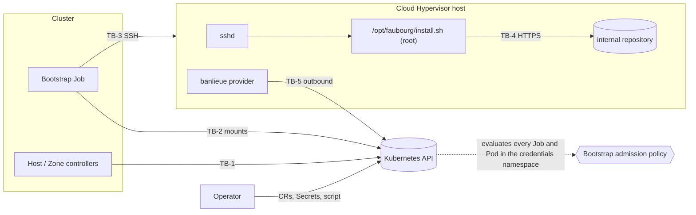

<!--
Copyright (c) 2026 Erick Bourgeois, faubourg
SPDX-License-Identifier: Apache-2.0
-->
# Threat Model

> **Status:** Living document. Last full pass **2026-11-07**, against the architecture
> defined by **ADR-0001 … ADR-0008** (all Accepted; ADR-0002 and ADR-0005 amended). Third
> pass: the shipped code is `crates/faubourg-api` (types, validation, the SSH Secret
> contract) and `crates/faubourg-controller` (the Host phase machine, `Provider` health and the
> bootstrap Job builder, as pure functions), with the bootstrap admission policy and the
> controller's RBAC in `deploy/`, both tested against a real API server (`make vap-test`).
> No reconciler and no bootstrap image exist yet. Every control below that lives in a planned
> component says so; nothing planned is written as though it exists.

## 1. What faubourg is, in security terms

faubourg groups bare-metal Cloud Hypervisor hosts into availability zones and bootstraps new
hosts for banlieue. Its security weight comes from two facts:

- It holds, or arranges access to, a **root-equivalent path onto every hypervisor**: the
  SSH credentials and the install script that runs as root.
- It decides **which hosts banlieue may place VMs on**, through the labels and existence of
  each host's banlieue `Provider`.

It runs no agent on the hosts and no VM scheduler (ADR-0002). After bootstrap, the only
management path to a host is banlieue's host-resident provider, outbound only.

## 2. Components

| Component | State | Where |
| --- | --- | --- |
| `faubourg-api` types, validation, Secret contract | shipped | `crates/faubourg-api` |
| CRDs | shipped | `deploy/crds/` (generated, drift-tested) |
| Default install script and sudoers rule | shipped as examples | `examples/host/` |
| Host phase machine and `Provider` health | shipped, pure functions, no cluster access | `crates/faubourg-controller/src/{phase,health}.rs` |
| Bootstrap Job builder | shipped, pure function | `crates/faubourg-controller/src/job.rs` |
| Bootstrap admission policy (ADR-0008) | shipped as manifests, tested on kind | `deploy/admission/`, `scripts/vap-test.sh` |
| Controller and bootstrap identities, RBAC | shipped as manifests, tested on kind | `deploy/rbac/controller.yaml` |
| Host controller (reconciler) | planned, roadmap 01 | |
| Bootstrap image (SSH client) | planned, roadmap 01 | |
| Zone controller | planned, roadmap 02 | |

## 3. Assets

| Asset | Why it matters |
| --- | --- |
| A-1 Placement credential (`ssh.placementSecretRef`) | Privileged on the host: writes `/opt/faubourg` and `/etc/sudoers.d`. Root-equivalent. |
| A-2 Scoped run credential (`ssh.secretRef`) | Can run exactly one root-owned script. |
| A-3 Install script source (ConfigMap or Secret) | Runs as root on every host whose copy is updated. Root-equivalent across the fleet. |
| A-4 `/opt/faubourg/install.sh` on the host | Root runs it under the sudo rule. |
| A-5 Host and AvailabilityZone CRs | Decide what gets bootstrapped and where VMs may land. |
| A-6 Each host's banlieue `Provider` labels | banlieue places by them (ADR-0003). |
| A-7 Pinned banlieue binary digest | The script's only proof the binary is genuine. |
| A-8 Bootstrap policy parameters (`faubourg-bootstrap-policy` in `faubourg-system`) | Name the only image that may mount A-1 and A-2, and the only objects that may be A-3. Root-equivalent across the fleet. |

## 4. Actors

| Actor | Trust |
| --- | --- |
| Platform administrator | Trusted. Writes the admission policy, its parameters (A-8), the RBAC and the Secrets. |
| Platform operator | Trusted for inventory. Writes Host and AvailabilityZone CRs. |
| Script maintainer | Trusted for A-3 only. Writes ConfigMaps in the credentials namespace; cannot change which image runs or which objects may be a script (A-8 lives elsewhere). |
| The Host controller | Not trusted with credentials. A compromise must not yield a key (ADR-0008). |
| VM consumer | Untrusted toward faubourg. Never reads or writes faubourg objects. |
| Cluster workloads | Untrusted. Must not read the credentials namespace or the script source. |
| Network attacker between cluster and hosts | Untrusted. |
| A compromised host | Untrusted toward the cluster and toward other hosts. |
| The internal artifact repository | Trusted for availability, not integrity: the digest decides. |

## 5. Trust boundaries

- **TB-1** controllers → Kubernetes API.
- **TB-2** Job pod → its mounted Secret(s) and script source.
- **TB-3** Job → host sshd (placement and run).
- **TB-4** install script → artifact repository (curl).
- **TB-5** banlieue provider → Kubernetes API (banlieue's boundary; see its threat model).

## 6. STRIDE, per boundary

### TB-1: controllers → Kubernetes API

| Threat | STRIDE | Control |
| --- | --- | --- |
| Controller reads SSH Secrets and leaks them | I | The controller's RBAC has no verb on Secrets or ConfigMaps anywhere, and no Pod create or subresource (`deploy/rbac/controller.yaml`; `vap-test` checks each with `auth can-i`). |
| Compromised controller creates a Job that prints a key (its own image, a command, `envFrom`, an extra volume, a mounted token, a host namespace) | I, E | ADR-0008: every Job in the credentials namespace must run the digest-pinned image from A-8 with no command or arguments, literal env, only the `credentials`, `placement` and `script` volumes read-only, the bootstrap ServiceAccount with no token, no host namespaces and the restricted profile (`deploy/admission/bootstrap-policy.yaml`, `faubourg-bootstrap-jobs`). Applies to cluster-admin too. Each rule has a refusing case in `scripts/vap-test.sh`. |
| Compromised controller mounts another host's key as the "install script", so placement copies it to a host it chooses | I | The `script` volume must be on A-8's `scriptSources` allowlist (`vap-test`: "another host's key as the script"). |
| A Secret reaches a pod by another route: a direct Pod, a Deployment, an ephemeral container, `kubectl set image` | I, E | `faubourg-bootstrap-pods`: only `system:serviceaccount:kube-system:job-controller` creates Pods there, for a Job it controls; Pod specs never change; no ephemeral containers (`vap-test`, including a real Job's pod). |
| The policy parameters are changed to admit another image | T, E | A-8 lives in `faubourg-system`; the controller has no ConfigMap write anywhere, and a script maintainer's ConfigMap access is in the credentials namespace (`vap-test`: "change the policy parameters: no"). Missing parameters deny every Job (`parameterNotFoundAction: Deny`, tested). |
| The policy fails open on an error | T | `failurePolicy: Fail` on both policies. Observed: a CEL error in an early draft denied every pod, the Job controller's included. |
| The controller's own Job fails the policy, so bootstrap never works | D | The builder's real output is the first case `vap-test` submits (`examples/bootstrap-job.rs`); the builder's shape is also unit-tested rule by rule (`job.rs`). |
| A Host CR smuggles a shell command into the bootstrap | T, E | The Host API carries no free-form argument: `bootstrap` is a method and a script reference only (`crates/faubourg-api/src/host.rs`, `BootstrapSpec`). Address, names and keys are validated fail closed (`HostSpec::validate`). |
| An address is read as an SSH option (`-oProxyCommand=...`) | E | `is_address` accepts only an IP or a lowercase DNS name, which cannot begin with `-` (`host.rs`, tested by `addresses_that_could_be_ssh_options_or_shell_are_refused`). |
| A zone's `providerLabels` overwrites faubourg's own label and moves hosts between zones | T | Keys under `faubourg.firestoned.io/` are refused (`zone.rs`, `REASON_RESERVED_LABEL`). |
| An unsupported storage mode is silently treated as Local | T | `Shared` is refused (`zone.rs`, `shared_storage_is_refused_in_v1`). |
| A Host is reported `Ready` (and its zone counted ready) when its provider is not running | S, T | The phase machine reaches `Ready` only from `ProviderHealth::Healthy` (`crates/faubourg-controller/src/phase.rs`, `nothing_reaches_ready_without_a_healthy_provider`). Healthy needs `Ready=True` for the `Provider`'s current generation **and** an `Alive` heartbeat; a missing, `Unknown`, stale-generation or not-yet-evaluated signal is unhealthy (`health.rs`). A refused spec is `Failed` whatever the cluster says (`a_refused_spec_fails_whatever_the_cluster_says`). |
| A forged `Provider` status marks a host healthy | S | Out of faubourg's control: whoever can write `Provider` status is inside banlieue's trust boundary (banlieue's threat model). faubourg only reads it. |
| A status message leaks a credential or command line | I | Phase messages are fixed strings or the validation summary, which names fields, never values from Secrets (`phase.rs`, `Decision::message`). |

### TB-2: Job pod → mounted Secret(s) and script source

| Threat | STRIDE | Control |
| --- | --- | --- |
| Job for host A mounts host B's credential | I, E | The builder mounts only the Secrets the Host names (`job.rs`, `it_mounts_only_its_hosts_secrets_and_the_script`). A compromised controller can still pair any key Secret with any address, but cannot read the key: the pinned image only uses it to authenticate, after verifying the host key (ADR-0008 decision 5, a requirement on the planned image). See R-5. |
| A missing Secret starts the pod without a credential | D | Secret volumes are not `optional` (`job.rs`). |
| The Job's environment carries a secret or a command line | I | Env holds only Host name, address, port, host key policy, the pinned fingerprint and the revoke flag, all literal (`job.rs`, `the_environment_is_literal_and_carries_only_connection_settings`, `the_job_names_secrets_but_holds_no_secret_material`). |
| Credential printed to logs | I | `Sensitive` redacts `Debug` (`crates/faubourg-api/src/credentials.rs`, `debug_never_prints_secret_material`). The Job's logging is planned. |
| Malformed username used as an option to ssh | E | `is_login_name` (`credentials.rs`). |
| Ambiguous credential (key and password) | S | Refused, `CredentialError::Ambiguous`. |
| Placement and run credential are the same Secret, so the scoped one is privileged | E | Refused, `REASON_SHARED_CREDENTIAL` (`host.rs`). |

### TB-3: Job → host sshd

| Threat | STRIDE | Control |
| --- | --- | --- |
| Man in the middle on first connection | S, I | `hostKeyPolicy: Strict` is the default (`host.rs`, `defaults_are_the_safe_ones`); TOFU must be explicit and its fingerprint is pinned in status and passed to the Job (`job.rs`, `a_pinned_tofu_fingerprint_is_passed_on`). Enforcement is in the planned bootstrap image, which must treat a Secret with `knownHosts` as `Strict` whatever the Job's env says (ADR-0008 decision 5). |
| A retry loop hammers a host with a refused key, or re-runs after drift | D | `podFailurePolicy` fails the Job at once on exit 64 (`ScriptDrift`) and 65 (host key refused); other failures retry twice; one hour deadline (`job.rs`, `drift_and_a_refused_host_key_fail_the_job_without_retries`). |
| Scoped account rewrites the script it may run as root | E | ADR-0005 decision 3: `/opt/faubourg` and the script are root-owned; sudoers allows only that path with no arguments (`examples/host/sudoers-faubourg`, `visudo -c` clean). Placement is in the planned Job. |
| Script run with attacker arguments | E | Sudo rule forbids arguments (`""`); the script refuses any (`examples/host/install.sh`). |
| Privileged placement key left on the host | E | `revokeAfterBootstrap` (ADR-0006 decision 4). Planned. |

### TB-4: install script → artifact repository

| Threat | STRIDE | Control |
| --- | --- | --- |
| Tampered or substituted banlieue binary | T | sha256 pinned in the root-owned script and checked before use (`examples/host/install.sh`); banlieue's installer verifies the VMM and firmware the same way (banlieue ADR-0084). |
| Downgrade to plain HTTP | T, I | `curl --proto '=https' --tlsv1.2`. |
| Internal CA not trusted | D | `CA_BUNDLE` setting. |

## 7. Hardening that exists today

- No free-form arguments or shell in any CR field (`BootstrapSpec`).
- Fail-closed validation of every Host and AvailabilityZone field (`validation.rs`, `host.rs`, `zone.rs`).
- Redacted `Debug` for credentials (`credentials.rs`).
- CRDs generated from types and drift-tested (`crd.rs`).
- The example install script: no arguments, fixed `PATH`, digest-pinned download, HTTPS only.
- Host health fails closed: only a current-generation `Ready=True` with an `Alive` heartbeat
  counts (`crates/faubourg-controller/src/health.rs`).
- Bootstrap Jobs are admitted only in the bootstrap shape, and Pods in the credentials
  namespace only from the Job controller (`deploy/admission/bootstrap-policy.yaml`), tested
  against a real API server (`make vap-test`).
- The controller holds no access to Secrets or ConfigMaps (`deploy/rbac/controller.yaml`).
- Supply chain: `banlieue-api` comes from crates.io, pinned to an exact version (`Cargo.toml`),
  and `cargo deny` refuses any git source or other registry (`deny.toml`, `[sources]`). CI
  (`.github/workflows/build.yaml`) verifies commit signatures and DCO sign-off, runs
  cargo-audit and cargo-deny, and refuses real infrastructure identifiers; every third-party
  action is SHA-pinned and the top-level token is `contents: read`. CodeQL (`codeql.yaml`),
  Semgrep (`sast.yaml`) and OpenSSF Scorecard (`scorecard.yaml`) run on `main`.

## 8. Accepted risks

| ID | Risk | Revisit when |
| --- | --- | --- |
| R-1 | Anyone who can write the script source (A-3) is root on every host at the next placement run. Mitigated by RBAC on that ConfigMap or Secret, and the allowlist (A-8) limits *which* objects can be a script, not what they contain. | The reconciler lands: decide whether the script's digest is pinned in A-8 too. |
| R-2 | A static SSH key in a Kubernetes Secret. | An SSH CA is available (ADR-0006 open question). |
| R-3 | The controls marked planned above do not exist yet. faubourg must not be deployed before roadmap 01's pass closes them. | Roadmap 01's threat-model pass. |
| R-4 | Cordon is advisory: banlieue does not yet exclude cordoned Providers (ADR-0003 decision 5). | banlieue grows a selector convention or a cordon field. |
| R-5 | A compromised controller can run the pinned image with any credential Secret against any address. A key with `knownHosts` only works against the hosts it pins. A password, or a key without `knownHosts` (TOFU), can be pointed at a server the attacker runs: the password is disclosed; a key's signature is bound to that session (ADR-0008 consequences). | SSH certificates replace static keys and passwords (R-2). |
| R-6 | Whoever administers the admission policy, its binding or A-8 (cluster-admin) can switch the protection off. | Never: that role is the root of trust for the cluster. |

## 9. Assumptions and out of scope

- banlieue's host-resident provider, its systemd units and polkit rule are banlieue's threat
  model, not this one.
- The hosts' OS, sshd configuration and patching are the operator's.
- The network path from cluster nodes to host SSH (ADR-0005 open question).
- Kubernetes 1.30 or later (ValidatingAdmissionPolicy GA). `vap-test` runs on kind's current
  release.
- kube-controller-manager runs with `--use-service-account-credentials`, so Job pods are
  created as `system:serviceaccount:kube-system:job-controller`. Without it the Pod rule
  refuses every bootstrap pod (fails closed). Verify on each distribution, k0s included.
- Re-bootstrap on a changed script source (ADR-0005 decision 8) needs the controller to see
  that the source changed, and it has no ConfigMap access. To be designed with the reconciler.

## 10. Revision log

| Date | ADRs | Summary |
| --- | --- | --- |
| 2026-11-07 | 0001 … 0007 | First pass, written with the architecture. Single install script and scoped sudo rule (ADR-0005). |
| 2026-11-07 | 0001 … 0007 | Second pass: ADR-0003 … ADR-0007 accepted; the phase machine and `Provider` health shipped (TB-1 rows added); CI and supply-chain hardening recorded; the Job namespace question raised. R-1 … R-4 unchanged: no reconciler or Job exists yet, so R-3 stays open. |
| 2026-11-07 | 0001 … 0008 | Third pass: ADR-0008 (admission policy) and the ADR-0002 and ADR-0005 amendments. The Job builder, the admission policy and the controller RBAC shipped and are tested on a real API server; TB-1 and TB-2 rows rewritten; A-8, R-5, R-6 and three actors added; the Job namespace question closed (credentials namespace). R-3 stays open: no reconciler or bootstrap image yet. |
