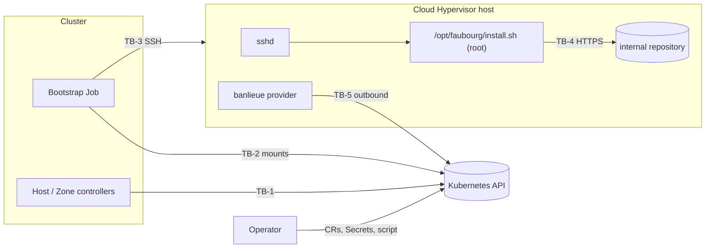

<!--
Copyright (c) 2026 Erick Bourgeois, faubourg
SPDX-License-Identifier: Apache-2.0
-->
# Threat Model

> **Status:** Living document. Last full pass **2026-11-07**, against the architecture
> defined by **ADR-0001 … ADR-0007** (all Accepted). Second pass: the shipped code is
> `crates/faubourg-api` (types, validation, the SSH Secret contract) and
> `crates/faubourg-controller` (the Host phase machine and the reading of a `Provider`'s
> health, as pure functions). No reconciler, Job or RBAC exists yet. Every control below that
> lives in a planned component says so; nothing planned is written as though it exists.

## 1. What faubourg is, in security terms

faubourg groups bare-metal Cloud Hypervisor hosts into availability zones and bootstraps new
hosts for banlieue. Its security weight comes from two facts:

- It holds, or arranges access to, a **root-equivalent path onto every hypervisor**: the
  SSH credentials and the install script that runs as root.
- It decides **which hosts banlieue may place VMs on**, through the labels and existence of
  each host's banlieue `Provider`.

It runs no agent on the hosts and no VM scheduler (ADR-0002). After bootstrap, the only
management path to a host is banlieue's host-resident provider, outbound only.

## 2. Components

| Component | State | Where |
| --- | --- | --- |
| `faubourg-api` types, validation, Secret contract | shipped | `crates/faubourg-api` |
| CRDs | shipped | `deploy/crds/` (generated, drift-tested) |
| Default install script and sudoers rule | shipped as examples | `examples/host/` |
| Host phase machine and `Provider` health | shipped, pure functions, no cluster access | `crates/faubourg-controller` |
| Host controller (reconciler, RBAC) | planned, roadmap 01 | |
| Zone controller | planned, roadmap 02 | |
| Bootstrap Job | planned, roadmap 01 | |

## 3. Assets

| Asset | Why it matters |
| --- | --- |
| A-1 Placement credential (`ssh.placementSecretRef`) | Privileged on the host: writes `/opt/faubourg` and `/etc/sudoers.d`. Root-equivalent. |
| A-2 Scoped run credential (`ssh.secretRef`) | Can run exactly one root-owned script. |
| A-3 Install script source (ConfigMap or Secret) | Runs as root on every host whose copy is updated. Root-equivalent across the fleet. |
| A-4 `/opt/faubourg/install.sh` on the host | Root runs it under the sudo rule. |
| A-5 Host and AvailabilityZone CRs | Decide what gets bootstrapped and where VMs may land. |
| A-6 Each host's banlieue `Provider` labels | banlieue places by them (ADR-0003). |
| A-7 Pinned banlieue binary digest | The script's only proof the binary is genuine. |

## 4. Actors

| Actor | Trust |
| --- | --- |
| Platform operator | Trusted. Writes CRs, Secrets and the script source. |
| VM consumer | Untrusted toward faubourg. Never reads or writes faubourg objects. |
| Cluster workloads | Untrusted. Must not read the credentials namespace or the script source. |
| Network attacker between cluster and hosts | Untrusted. |
| A compromised host | Untrusted toward the cluster and toward other hosts. |
| The internal artifact repository | Trusted for availability, not integrity: the digest decides. |

## 5. Trust boundaries

- **TB-1** controllers → Kubernetes API.
- **TB-2** Job pod → its mounted Secret(s) and script source.
- **TB-3** Job → host sshd (placement and run).
- **TB-4** install script → artifact repository (curl).
- **TB-5** banlieue provider → Kubernetes API (banlieue's boundary; see its threat model).

## 6. STRIDE, per boundary

### TB-1: controllers → Kubernetes API

| Threat | STRIDE | Control |
| --- | --- | --- |
| Controller reads SSH Secrets and leaks them | I | Planned: controller RBAC has no Secret access in the credentials namespace (ADR-0006 consequence). Not yet built. |
| A Host CR smuggles a shell command into the bootstrap | T, E | The Host API carries no free-form argument: `bootstrap` is a method and a script reference only (`crates/faubourg-api/src/host.rs`, `BootstrapSpec`). Address, names and keys are validated fail closed (`HostSpec::validate`). |
| An address is read as an SSH option (`-oProxyCommand=...`) | E | `is_address` accepts only an IP or a lowercase DNS name, which cannot begin with `-` (`host.rs`, tested by `addresses_that_could_be_ssh_options_or_shell_are_refused`). |
| A zone's `providerLabels` overwrites faubourg's own label and moves hosts between zones | T | Keys under `faubourg.firestoned.io/` are refused (`zone.rs`, `REASON_RESERVED_LABEL`). |
| An unsupported storage mode is silently treated as Local | T | `Shared` is refused (`zone.rs`, `shared_storage_is_refused_in_v1`). |
| A Host is reported `Ready` (and its zone counted ready) when its provider is not running | S, T | The phase machine reaches `Ready` only from `ProviderHealth::Healthy` (`crates/faubourg-controller/src/phase.rs`, `nothing_reaches_ready_without_a_healthy_provider`). Healthy needs `Ready=True` for the `Provider`'s current generation **and** an `Alive` heartbeat; a missing, `Unknown`, stale-generation or not-yet-evaluated signal is unhealthy (`health.rs`). A refused spec is `Failed` whatever the cluster says (`a_refused_spec_fails_whatever_the_cluster_says`). |
| A forged `Provider` status marks a host healthy | S | Out of faubourg's control: whoever can write `Provider` status is inside banlieue's trust boundary (banlieue's threat model). faubourg only reads it. |
| A status message leaks a credential or command line | I | Phase messages are fixed strings or the validation summary, which names fields, never values from Secrets (`phase.rs`, `Decision::message`). |

### TB-2: Job pod → mounted Secret(s) and script source

| Threat | STRIDE | Control |
| --- | --- | --- |
| Job for host A mounts host B's credential | I, E | Planned: the Job mounts only the Secrets its Host names. Not yet built. |
| Credential printed to logs | I | `Sensitive` redacts `Debug` (`crates/faubourg-api/src/credentials.rs`, `debug_never_prints_secret_material`). The Job's logging is planned. |
| Malformed username used as an option to ssh | E | `is_login_name` (`credentials.rs`). |
| Ambiguous credential (key and password) | S | Refused, `CredentialError::Ambiguous`. |
| Placement and run credential are the same Secret, so the scoped one is privileged | E | Refused, `REASON_SHARED_CREDENTIAL` (`host.rs`). |

### TB-3: Job → host sshd

| Threat | STRIDE | Control |
| --- | --- | --- |
| Man in the middle on first connection | S, I | `hostKeyPolicy: Strict` is the default (`host.rs`, `defaults_are_the_safe_ones`); TOFU must be explicit and its fingerprint is pinned in status. Enforcement is in the planned Job. |
| Scoped account rewrites the script it may run as root | E | ADR-0005 decision 3: `/opt/faubourg` and the script are root-owned; sudoers allows only that path with no arguments (`examples/host/sudoers-faubourg`, `visudo -c` clean). Placement is in the planned Job. |
| Script run with attacker arguments | E | Sudo rule forbids arguments (`""`); the script refuses any (`examples/host/install.sh`). |
| Privileged placement key left on the host | E | `revokeAfterBootstrap` (ADR-0006 decision 4). Planned. |

### TB-4: install script → artifact repository

| Threat | STRIDE | Control |
| --- | --- | --- |
| Tampered or substituted banlieue binary | T | sha256 pinned in the root-owned script and checked before use (`examples/host/install.sh`); banlieue's installer verifies the VMM and firmware the same way (banlieue ADR-0084). |
| Downgrade to plain HTTP | T, I | `curl --proto '=https' --tlsv1.2`. |
| Internal CA not trusted | D | `CA_BUNDLE` setting. |

## 7. Hardening that exists today

- No free-form arguments or shell in any CR field (`BootstrapSpec`).
- Fail-closed validation of every Host and AvailabilityZone field (`validation.rs`, `host.rs`, `zone.rs`).
- Redacted `Debug` for credentials (`credentials.rs`).
- CRDs generated from types and drift-tested (`crd.rs`).
- The example install script: no arguments, fixed `PATH`, digest-pinned download, HTTPS only.
- Host health fails closed: only a current-generation `Ready=True` with an `Alive` heartbeat
  counts (`crates/faubourg-controller/src/health.rs`).
- Supply chain: `banlieue-api` is a git dependency pinned by full commit rev (`Cargo.toml`),
  and `cargo deny` refuses any other git source or registry (`deny.toml`, `[sources]`). CI
  (`.github/workflows/build.yaml`) verifies commit signatures and DCO sign-off, runs
  cargo-audit and cargo-deny, and refuses real infrastructure identifiers; every third-party
  action is SHA-pinned and the top-level token is `contents: read`. CodeQL (`codeql.yaml`),
  Semgrep (`sast.yaml`) and OpenSSF Scorecard (`scorecard.yaml`) run on `main`.

## 8. Accepted risks

| ID | Risk | Revisit when |
| --- | --- | --- |
| R-1 | Anyone who can write the script source (A-3) is root on every host at the next placement run. Mitigated only by RBAC on that ConfigMap or Secret. | The controller lands: decide whether the script source must be signed, or its digest pinned in controller config. |
| R-2 | A static SSH key in a Kubernetes Secret. | An SSH CA is available (ADR-0006 open question). |
| R-3 | The controls marked planned above do not exist yet. faubourg must not be deployed before roadmap 01's pass closes them. | Roadmap 01's threat-model pass. |
| R-4 | Cordon is advisory: banlieue does not yet exclude cordoned Providers (ADR-0003 decision 5). | banlieue grows a selector convention or a cordon field. |

## 9. Assumptions and out of scope

- banlieue's host-resident provider, its systemd units and polkit rule are banlieue's threat
  model, not this one.
- The hosts' OS, sshd configuration and patching are the operator's.
- The network path from cluster nodes to host SSH (ADR-0005 open question).
- Where the bootstrap Job runs. A pod can mount Secrets and ConfigMaps only from its own
  namespace, but ADR-0005 puts the script source in the controller's namespace and ADR-0006
  puts the SSH Secrets in the credentials namespace. This must be settled (an ADR-0005
  amendment) before the Job builder is written. It decides which namespace holds A-1, A-2
  and A-3 together, and so which RBAC protects them.

## 10. Revision log

| Date | ADRs | Summary |
| --- | --- | --- |
| 2026-11-07 | 0001 … 0007 | First pass, written with the architecture. Single install script and scoped sudo rule (ADR-0005). |
| 2026-11-07 | 0001 … 0007 | Second pass: ADR-0003 … ADR-0007 accepted; the phase machine and `Provider` health shipped (TB-1 rows added); CI and supply-chain hardening recorded; the Job namespace question raised. R-1 … R-4 unchanged: no reconciler or Job exists yet, so R-3 stays open. |
