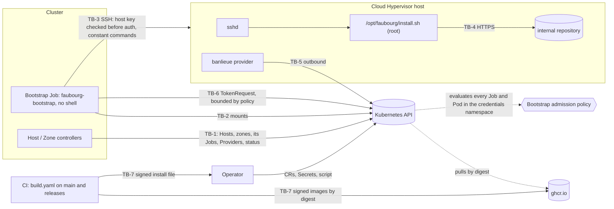

<!--
Copyright (c) 2026 Erick Bourgeois, faubourg
SPDX-License-Identifier: Apache-2.0
-->
# Threat Model

> **Status:** Living document. Last full pass **2026-11-07**, against the architecture
> defined by **ADR-0001 … ADR-0012** (ADR-0001 … ADR-0011 Accepted, ADR-0012 Proposed;
> ADR-0002, ADR-0005, ADR-0007, ADR-0008 and ADR-0009 amended). Seventh pass: the shipped code is
> `crates/faubourg-api` (types, validation, the SSH Secret contract, the Job-to-image
> contract), `crates/faubourg-controller` (the Host reconciler and its binary) and
> `crates/faubourg-bootstrap` (the bootstrap image's binary, on russh), with the admission
> policy, the RBAC and the controller Deployment in `deploy/` and the image in
> `images/bootstrap/`. The policy (`make vap-test`), the controller with its own RBAC
> (`make controller-test`) and the image against a real OpenSSH host (`make bootstrap-test`)
> are tested in CI, and a Host is bootstrapped end to end on kind with the real image, its
> Provider created and its first provider token minted and delivered (`make e2e-test`; banlieue
> simulated), installed from the rendered install file with the controller running as its
> Deployment. CI builds, signs and publishes both images from `main` and releases (ADR-0012);
> no release has been cut yet, and nothing has run against a real hypervisor. Every control below that lives in a planned
> component says so; nothing planned is written as though it exists.

## 1. What faubourg is, in security terms

faubourg groups bare-metal Cloud Hypervisor hosts into availability zones and bootstraps new
hosts for banlieue. Its security weight comes from two facts:

- It holds, or arranges access to, a **root-equivalent path onto every hypervisor**: the
  SSH credentials and the install script that runs as root.
- It decides **which hosts banlieue may place VMs on**, through the labels and existence of
  each host's banlieue `Provider`.

It runs no agent on the hosts and no VM scheduler (ADR-0002). After bootstrap, the only
management path to a host is banlieue's host-resident provider, outbound only.

## 2. Components

| Component | State | Where |
| --- | --- | --- |
| `faubourg-api` types, validation, Secret contract | shipped | `crates/faubourg-api` |
| CRDs | shipped | `deploy/crds/` (generated, drift-tested) |
| Default install script and sudoers rule | shipped as examples | `examples/host/` |
| Host phase machine and `Provider` health | shipped, pure functions, no cluster access | `crates/faubourg-controller/src/{phase,health}.rs` |
| Bootstrap Job builder | shipped, pure function | `crates/faubourg-controller/src/job.rs` |
| Bootstrap admission policy (ADR-0008) | shipped as manifests, tested on kind | `deploy/admission/`, `scripts/vap-test.sh` |
| Controller and bootstrap identities, RBAC | shipped as manifests, tested on kind | `deploy/rbac/controller.yaml` |
| Host controller (reconciler, binary) | shipped, tested on kind with its own RBAC; image not published | `crates/faubourg-controller/src/{plan,controller,config,main}.rs`, `deploy/controller/`, `scripts/controller-test.sh` |
| Creating and labelling Providers (ADR-0011) | shipped, tested on kind | `crates/faubourg-controller/src/provider.rs`, `scripts/controller-test.sh`, `scripts/e2e-test.sh` |
| Provider token minting and the `faubourg-provider-tokens` policy (ADR-0011) | shipped, tested on kind | `crates/faubourg-bootstrap/src/provider.rs`, `deploy/admission/bootstrap-policy.yaml`, `scripts/vap-test.sh` |
| Bootstrap image (SSH client) | shipped, tested against OpenSSH; published by CI from `main` (ADR-0012) | `crates/faubourg-bootstrap`, `images/bootstrap/Containerfile`, `scripts/bootstrap-test.sh` |
| Image publication and the install file (ADR-0012) | shipped in CI; no release cut yet | `.github/workflows/build.yaml` (`images`, `release-manifests`), `images/`, `scripts/render-manifests.sh` |
| Zone controller | planned, roadmap 02 | |

## 3. Assets

| Asset | Why it matters |
| --- | --- |
| A-1 Placement credential (`ssh.placementSecretRef`) | Privileged on the host: writes `/opt/faubourg` and `/etc/sudoers.d`. Root-equivalent. |
| A-2 Scoped run credential (`ssh.secretRef`) | Can run exactly one root-owned script. |
| A-3 Install script source (ConfigMap or Secret) | Runs as root on every host whose copy is updated. Root-equivalent across the fleet. |
| A-4 `/opt/faubourg/install.sh` on the host | Root runs it under the sudo rule. |
| A-5 Host and AvailabilityZone CRs | Decide what gets bootstrapped and where VMs may land. |
| A-6 Each host's banlieue `Provider` labels | banlieue places by them (ADR-0003), and `faubourg.firestoned.io/host` decides which Provider's health is the host's (ADR-0009 decision 5). |
| A-7 Pinned banlieue binary digest | The script's only proof the binary is genuine. |
| A-8 Bootstrap policy parameters (`faubourg-bootstrap-policy` in `faubourg-system`) | Name the only image that may mount A-1 and A-2, and the only objects that may be A-3. Root-equivalent across the fleet. |
| A-9 The controller's ServiceAccount token | Creates and deletes Jobs in the credentials namespace and writes Host status. Cannot read a credential (ADR-0008), but can run the pinned image with any of them (R-5). |
| A-10 The host's provider token | Authenticates as the host Provider's ServiceAccount for a day: reports that Provider's status and serves its machines. Minted by the bootstrap pod, held only by the host (ADR-0011). |
| A-11 The bootstrap pods' projected token | `faubourg-bootstrap` for 600 seconds: mints A-10 for provider ServiceAccounts of one class. |
| A-12 The published images and the install file | The bootstrap image is the fleet's root of trust; the install file decides which digest the admission policy admits (ADR-0012). |

## 4. Actors

| Actor | Trust |
| --- | --- |
| Platform administrator | Trusted. Writes the admission policy, its parameters (A-8), the RBAC and the Secrets. |
| Platform operator | Trusted for inventory. Writes Host and AvailabilityZone CRs. |
| Script maintainer | Trusted for A-3 only. Writes ConfigMaps in the credentials namespace; cannot change which image runs or which objects may be a script (A-8 lives elsewhere). |
| The Host controller | Not trusted with credentials. A compromise must not yield a key (ADR-0008). |
| banlieue administrator | Trusted by banlieue. Writes Providers and their labels in banlieue's namespace, so can attach a Provider to a Host by label (R-7). |
| VM consumer | Untrusted toward faubourg. Never reads or writes faubourg objects. |
| Cluster workloads | Untrusted. Must not read the credentials namespace or the script source. |
| Network attacker between cluster and hosts | Untrusted. |
| A compromised host | Untrusted toward the cluster and toward other hosts. |
| The internal artifact repository | Trusted for availability, not integrity: the digest decides. |

## 5. Trust boundaries

- **TB-1** controllers → Kubernetes API: Hosts, zones, the Jobs and pods in the credentials
  namespace, and Providers in banlieue's namespace.
- **TB-2** Job pod → its mounted Secret(s) and script source.
- **TB-3** Job → host sshd (placement and run).
- **TB-4** install script → artifact repository (curl).
- **TB-5** banlieue provider → Kubernetes API (banlieue's boundary; see its threat model).
- **TB-6** bootstrap pod → Kubernetes API: TokenRequest for the host's provider (ADR-0011).
- **TB-7** this repository's CI → the registry and the release → the operator's cluster: how an
  image and the install file come to be trusted (ADR-0012).

## 6. STRIDE, per boundary

### TB-1: controllers → Kubernetes API

| Threat | STRIDE | Control |
| --- | --- | --- |
| Controller reads SSH Secrets and leaks them | I | The controller's RBAC has no verb on Secrets or ConfigMaps anywhere, and no Pod create or subresource (`deploy/rbac/controller.yaml`; `vap-test` checks each with `auth can-i`). |
| Compromised controller creates a Job that prints a key (its own image, a command, `envFrom`, an extra volume, a mounted token, a host namespace) | I, E | ADR-0008: every Job in the credentials namespace must run the digest-pinned image from A-8 with no command or arguments, literal env, only the `credentials`, `placement` and `script` volumes read-only, the bootstrap ServiceAccount with no token, no host namespaces and the restricted profile (`deploy/admission/bootstrap-policy.yaml`, `faubourg-bootstrap-jobs`). Applies to cluster-admin too. Each rule has a refusing case in `scripts/vap-test.sh`. |
| Compromised controller mounts another host's key as the "install script", so placement copies it to a host it chooses | I | The `script` volume must be on A-8's `scriptSources` allowlist (`vap-test`: "another host's key as the script"). |
| A Secret reaches a pod by another route: a direct Pod, a Deployment, an ephemeral container, `kubectl set image` | I, E | `faubourg-bootstrap-pods`: only `system:serviceaccount:kube-system:job-controller` creates Pods there, for a Job it controls; Pod specs never change; no ephemeral containers (`vap-test`, including a real Job's pod). |
| The policy parameters are changed to admit another image | T, E | A-8 lives in `faubourg-system`; the controller has no ConfigMap write anywhere, and a script maintainer's ConfigMap access is in the credentials namespace (`vap-test`: "change the policy parameters: no"). Missing parameters deny every Job (`parameterNotFoundAction: Deny`, tested). |
| The policy fails open on an error | T | `failurePolicy: Fail` on both policies. Observed: a CEL error in an early draft denied every pod, the Job controller's included. |
| The controller's own Job fails the policy, so bootstrap never works | D | The builder's real output is the first case `vap-test` submits (`examples/bootstrap-job.rs`); the builder's shape is also unit-tested rule by rule (`job.rs`). |
| A Host CR smuggles a shell command into the bootstrap | T, E | The Host API carries no free-form argument: `bootstrap` is a method and a script reference only (`crates/faubourg-api/src/host.rs`, `BootstrapSpec`). Address, names and keys are validated fail closed (`HostSpec::validate`). |
| An address is read as an SSH option (`-oProxyCommand=...`) | E | `is_address` accepts only an IP or a lowercase DNS name, which cannot begin with `-` (`host.rs`, tested by `addresses_that_could_be_ssh_options_or_shell_are_refused`). |
| A zone's `providerLabels` overwrites faubourg's own label and moves hosts between zones | T | Keys under `faubourg.firestoned.io/` are refused (`zone.rs`, `REASON_RESERVED_LABEL`). |
| An unsupported storage mode is silently treated as Local | T | `Shared` is refused (`zone.rs`, `shared_storage_is_refused_in_v1`). |
| A Host is reported `Ready` (and its zone counted ready) when its provider is not running | S, T | The phase machine reaches `Ready` only from `ProviderHealth::Healthy` (`crates/faubourg-controller/src/phase.rs`, `nothing_reaches_ready_without_a_healthy_provider`). Healthy needs `Ready=True` for the `Provider`'s current generation **and** an `Alive` heartbeat; a missing, `Unknown`, stale-generation or not-yet-evaluated signal is unhealthy (`health.rs`). A refused spec is `Failed` whatever the cluster says (`a_refused_spec_fails_whatever_the_cluster_says`). |
| A Job someone else made, with the Host's labels, is taken as the Host's (a forged `Complete` record, or a squatter) | S, T | Only a Job whose controller `ownerReference` carries the Host's UID counts (`job.rs`, `owned_by`, `only_the_hosts_own_jobs_are_its_jobs`); a recreated Host does not inherit the old one's Jobs (`plan.rs`, `a_job_of_a_recreated_host_is_not_its_own`). |
| The controller deletes a Job it does not own | T, D | Only owned Jobs are ever deleted (`plan.rs`, `a_job_the_host_does_not_own_is_ignored_and_never_deleted`). |
| A Job squats the name of a Host's next Job, so bootstrap never starts | D | The create fails with `AlreadyExists`, which the controller logs and retries (`controller.rs`, `JobNameTaken`); it never adopts that Job. Creating a Job there already needs a role trusted with the namespace. |
| Cordoning a host, moving it to another zone, or upgrading the controller re-runs root's install on it | T | A new Job only when the bootstrap inputs change: `address`, `ssh` and the resolved script source, hashed into the Job's annotation; `zoneRef`, `cordoned` and the image are not inputs (`job.rs`, `cordon_zone_and_image_are_not_bootstrap_inputs`, `the_inputs_encoding_is_pinned`; `controller-test`: "no new Job after a cordon"). |
| A failed bootstrap is retried in a loop against a host (a wrong key, a refused host key) | D | The controller never replaces a failed current Job; the Host stays `Failed` until its inputs change or an operator deletes the Job (`plan.rs`, `a_failed_job_is_kept_and_not_retried`). |
| A Host bootstraps into a missing or `Shared` zone | T | No Job until the zone exists and validates (`phase.rs`, `a_missing_zone_holds_a_host_that_has_not_started`; `controller-test`). |
| A Host name longer than a label value is truncated into another host's label | T | The CRD refuses names over 63 characters (CEL rule in `deploy/crds/faubourg.firestoned.io_hosts.yaml`; `controller-test`), and the builder refuses them too. |
| The controller starts with an image by tag, or with a malformed namespace or script source | T | It refuses to start (`config.rs`, `the_image_is_required_and_must_be_pinned`, `a_malformed_default_script_is_refused`; `controller-test`: "the controller refuses an image by tag"). An image other than A-8's is refused by the API server anyway. |
| Two controller instances race and write conflicting state | T | `replicas: 1`, `Recreate` (`deploy/controller/deployment.yaml`). Every write is idempotent: Jobs by a name derived from the Host, status by server-side apply under `faubourg.firestoned.io/host-controller`. |
| A deleted Host leaves a Job running with its credentials mounted | I | Jobs are owned by their Host and garbage collected with it (`controller-test`: "the Job is garbage collected"). |
| The controller reads more of banlieue's namespace than Providers | I | A Role there grants `get`, `list`, `watch`, `create`, `patch` on `providers.banlieue.io` only: no delete, no Secret, no `serviceaccounts/token` (`deploy/rbac/controller.yaml`; `vap-test` checks each). |
| faubourg overwrites an adopted host's Provider, or deletes one | T, D | An adopted host's Provider gets labels only, by server-side apply, never its spec (`provider.rs`, `an_adopted_host_gets_labels_and_nothing_else`; `controller-test` checks faubourg owns no spec field). faubourg holds no delete on Providers and sets no ownerReference, so deleting a Host keeps its Provider (`controller-test`, `e2e-test`). |
| A Host bootstraps under a Managed class, so banlieue would also run an in-cluster provider for it | T | Only an `External` class: otherwise the Host is `Failed` and nothing is created (`plan.rs`, `a_class_that_is_missing_or_not_external_fails_the_host_and_creates_nothing`; `controller-test`). |
| A Job runs before the provider has an identity, so the token request fails or targets a stale ServiceAccount | D | No Job until banlieue reports `status.workload.mode: External` (`plan.rs`, `no_job_until_banlieue_gives_the_provider_its_identity`; `controller-test`, `e2e-test`). |
| A forged `Provider` status marks a host healthy | S | Out of faubourg's control: whoever can write `Provider` status is inside banlieue's trust boundary (banlieue's threat model). faubourg only reads it. |
| A status message leaks a credential or command line | I | Phase messages are fixed strings or the validation summary, which names fields, never values from Secrets (`phase.rs`, `Decision::message`). |
| The controller's logs leak an address or a secret | I | Logs carry Host, zone and Job names, phases and reasons only (`controller.rs`); the controller never reads a Secret. `controller-test` fails if a fixture address appears in the logs. |
| Two Providers labelled with one host, and faubourg reports the healthier | S | More than one is `ProviderAmbiguous`, never `Ready` (`health.rs`, `of_labelled`; `plan.rs`, `two_labelled_providers_are_never_picked_from`; `controller-test`). |

### TB-2: Job pod → mounted Secret(s) and script source

| Threat | STRIDE | Control |
| --- | --- | --- |
| Job for host A mounts host B's credential | I, E | The builder mounts only the Secrets the Host names (`job.rs`, `it_mounts_only_its_hosts_secrets_and_the_script`). A compromised controller can still pair any key Secret with any address, but cannot read the key: the pinned image only uses it to authenticate, after verifying the host key (ADR-0008 decision 5, `crates/faubourg-bootstrap/src/ssh.rs`). See R-5. |
| A missing Secret starts the pod without a credential | D | Secret volumes are not `optional` (`job.rs`). |
| The Job's environment carries a secret or a command line | I | Env holds only Host name, address, port, host key policy, the pinned fingerprint and the revoke flag, all literal (`job.rs`, `the_environment_is_literal_and_carries_only_connection_settings`, `the_job_names_secrets_but_holds_no_secret_material`). |
| Credential printed to logs | I | `Sensitive` redacts `Debug` (`crates/faubourg-api/src/credentials.rs`, `debug_never_prints_secret_material`). The image's `Config` prints names and sizes only (`crates/faubourg-bootstrap/src/config.rs`, `debug_shows_no_script_and_no_credential`); errors name inputs, never values (`errors_never_carry_the_value`). `bootstrap-test` fails if a key or the script's content reaches the log. |
| The image runs something other than the bootstrap: a shell, a debugger, another program in the image | E | The image is one static binary on `scratch`: no shell, no package manager, no `ssh` (`images/bootstrap/Containerfile`; `bootstrap-test`: "the image has no shell"). The policy already forbids a command (ADR-0008). |
| A malformed mount or environment makes the image act on a default | T | Every input is validated before a connection is opened; anything missing or malformed exits 1 (`config.rs`, `malformed_environment_is_refused`, `no_run_credential_or_script_is_refused`). |
| Malformed username used as an option to ssh | E | `is_login_name` (`credentials.rs`). |
| Ambiguous credential (key and password) | S | Refused, `CredentialError::Ambiguous`. |
| Placement and run credential are the same Secret, so the scoped one is privileged | E | Refused, `REASON_SHARED_CREDENTIAL` (`host.rs`). |

### TB-3: Job → host sshd

| Threat | STRIDE | Control |
| --- | --- | --- |
| Man in the middle | S, I | The host key is judged in russh's `check_server_key`, before any authentication is sent (`crates/faubourg-bootstrap/src/ssh.rs`). `Strict` is the default (`host.rs`, `defaults_are_the_safe_ones`) and accepts nothing without `knownHosts`; a Secret with `knownHosts` is always strict (`hostkey.rs`, `known_hosts_overrides_trust_on_first_use`); `@revoked`, hashed and wildcard lines never admit a key (`hostkey.rs` tests). Every connection of a run must see the first one's key (`first_use_accepts_the_first_key_then_only_it`). RSA host keys and host certificates are refused. All of it is exercised against OpenSSH in `bootstrap-test`. |
| TOFU pins an attacker's key, or a pod pins junk into a Host | S, T | TOFU must be explicit; the first connection is open to interception (accepted, R-8). The controller pins a fingerprint only from the Host's own succeeded Job, read from that Job's own pod, only when well-formed and none is pinned yet; a pinned key is never replaced (`plan.rs`, `a_first_use_key_is_pinned_from_a_succeeded_job`, `a_pinned_key_is_never_replaced`, `no_key_is_pinned_from_a_failed_job_a_strict_host_or_another_jobs_pod`, `a_malformed_report_pins_nothing`). |
| A Host field or the script becomes a shell command on the host | E | Every command is a constant (`crates/faubourg-bootstrap/src/remote.rs`); the script, the sudo rule, a key to revoke and the provider credential bundle travel on stdin. The default install script validates the bundle's names and token characters before using them (`examples/host/install.sh`). The programs set their own `PATH` and contain no single quote (`programs_survive_single_quoting`). |
| A half-written script or sudo rule is left in place | T | Both are written to a temporary file in the same directory and moved into place; the rule only after `visudo -cf` accepts it; the result is checked again with the scoped account before anything runs (`steps.rs`, `placement_writes_script_and_rule_checks_again_then_runs`, `still_not_in_place_after_placement_is_drift`). |
| The script is in place but writable by someone other than root | E | "In place" requires `root:root 0755` on `/opt/faubourg` and the script, not only the hash (`remote.rs`, `in_place_needs_owner_mode_and_hash`; `bootstrap-test`: "a script made writable is drift, not run"). |
| A retry loop hammers a host with a refused key, or re-runs after drift | D | `podFailurePolicy` fails the Job at once on exit 64 (`ScriptDrift`) and 65 (host key refused); other failures retry twice; one hour deadline (`job.rs`, `drift_and_a_refused_host_key_fail_the_job_without_retries`). |
| Scoped account rewrites the script it may run as root | E | ADR-0005 decision 3: `/opt/faubourg` and the script are root-owned; sudoers allows only that path with no arguments (`examples/host/sudoers-faubourg`; the image writes the same rule, `remote.rs`, `the_sudo_rule_allows_the_script_and_no_arguments`; `bootstrap-test` checks owner, mode and content). |
| Script run with attacker arguments | E | Sudo rule forbids arguments (`""`); the script refuses any (`examples/host/install.sh`). |
| Privileged placement key left on the host | E | `revokeAfterBootstrap` removes it from the placing account's `authorized_keys` right after a successful placement, and a `grep` error leaves the file untouched (`remote.rs`, `steps.rs`; `bootstrap-test`: the key is gone, only from that account, and no longer works). A password placement credential cannot be revoked by key: prefer a key. |

### TB-4: install script → artifact repository

| Threat | STRIDE | Control |
| --- | --- | --- |
| Tampered or substituted banlieue binary | T | sha256 pinned in the root-owned script and checked before use (`examples/host/install.sh`); banlieue's installer verifies the VMM and firmware the same way (banlieue ADR-0084). |
| Downgrade to plain HTTP | T, I | `curl --proto '=https' --tlsv1.2`. |
| Internal CA not trusted | D | `CA_BUNDLE` setting. |

### TB-6: bootstrap pod → Kubernetes API (provider tokens)

| Threat | STRIDE | Control |
| --- | --- | --- |
| The bootstrap identity mints a token for banlieue's operator, or for any ServiceAccount in its namespace | E | `faubourg-provider-tokens`: from `faubourg-bootstrap`, a TokenRequest is admitted only for a name starting with A-8's `providerServiceAccountPrefix` (`banlieue-provider-<class>-`), at most 86400 seconds, for the API server's own audiences (A-8's `apiAudiences`), bound to no object (`deploy/admission/bootstrap-policy.yaml`; `vap-test`: the operator's ServiceAccount, another class, 48 hours, another audience and a bound token are each refused). |
| The bootstrap identity does anything else | E | Its only RBAC is `create` on `serviceaccounts/token` in banlieue's namespace (`deploy/rbac/controller.yaml`; `vap-test` checks it cannot read a Secret there or in the credentials namespace, nor mint elsewhere). |
| A long-lived or differently scoped bootstrap token | E | The Job policy admits the `kube-api` volume only as a projected token of at most 600 seconds for the default audience plus `kube-root-ca.crt`; `automountServiceAccountToken` stays false (`vap-test`: a day's token, another audience, a Secret in the projection, another ConfigMap, a Secret named `kube-api`). |
| The controller mints or sees a provider token | I, E | It holds no `serviceaccounts/token` anywhere (`vap-test`), and the token never passes through it: minted in the pod, sent on the install script's stdin, never in the Job, a Secret or a log (`e2e-test` checks the Job, its log and the controller's log). |
| The provider token reaches a server the attacker runs | I | A compromised controller can pair a password or first-use credential with an address of its choosing (R-5), and the token goes there. It is one provider's, for a day. A `knownHosts` key confines it to the pinned host. |
| A pod cannot read its own credentials and fails in a way that hides a misconfiguration | D | `fsGroup` makes the root-owned Secret files readable by the bootstrap user (`job.rs`, `the_restricted_security_profile`); found by `e2e-test`, which runs the real image against real mounts. |

### TB-7: CI → registry and release → the operator's cluster

| Threat | STRIDE | Control |
| --- | --- | --- |
| A substituted or tampered image is installed | T | Images are pulled by digest only: `deploy/` holds `@sha256:<digest>` placeholders no runtime accepts, the render refuses an image not pinned by digest (`scripts/render-manifests.sh`, `render-manifests-test`), and the admission policy admits only the bootstrap digest the operator applied (ADR-0008). Each image is Cosign-signed keyless by digest and attested (`build.yaml`, `images`); `docs/guides/installing.md` gives the verification. |
| A pull request, from a fork or a branch, publishes a signed image | E | Images are pushed and signed only on a push to `main` and on a release (`build.yaml`, `PUBLISH`); pull requests build without pushing. A `main` image's certificate names `refs/heads/main`, so the documented release identity refuses it. |
| The controller runs one bootstrap digest and the policy admits another | T, D | Both come from one render, which fails unless the bootstrap image appears exactly twice (`render-manifests.sh`; `render-manifests-test`; `e2e-test` checks the running Deployment against the policy parameter). A mismatch fails closed anyway: the API server refuses every Job. |
| A tampered install file | T | Signed with `cosign sign-blob` by the release workflow and attached with its bundle (`build.yaml`, `release-manifests`); `docs/guides/installing.md` verifies it against the release tag's identity. |
| A release ships a known-vulnerable image | T | Trivy scans every pushed digest; a release fails on a CRITICAL or HIGH finding (`build.yaml`, `images`). |
| A compromised release workflow or `main` publishes a signed malicious image | T, E | Not prevented here: commit signatures and DCO are verified, every action is SHA-pinned and the token is read-only except in the two jobs that need more. The operator still chooses which release digest to apply. Accepted, R-12. |

## 7. Hardening that exists today

- No free-form arguments or shell in any CR field (`BootstrapSpec`).
- Fail-closed validation of every Host and AvailabilityZone field (`validation.rs`, `host.rs`, `zone.rs`).
- Redacted `Debug` for credentials (`credentials.rs`).
- CRDs generated from types and drift-tested (`crd.rs`).
- The example install script: no arguments, fixed `PATH`, digest-pinned download, HTTPS only.
- Host health fails closed: only a current-generation `Ready=True` with an `Alive` heartbeat
  counts (`crates/faubourg-controller/src/health.rs`).
- Bootstrap Jobs are admitted only in the bootstrap shape, and Pods in the credentials
  namespace only from the Job controller (`deploy/admission/bootstrap-policy.yaml`), tested
  against a real API server (`make vap-test`).
- A bootstrapped host's Provider is created by faubourg and its first token minted by the
  bootstrap pod, bounded by RBAC and `faubourg-provider-tokens`; the controller never holds a
  token (`make e2e-test`).
- The bootstrap image is one static binary with no shell, runs as UID 65532, verifies the
  host key before authenticating, and sends only constant commands (`crates/faubourg-bootstrap`,
  `images/bootstrap/Containerfile`), tested against OpenSSH (`make bootstrap-test`).
- The controller holds no access to Secrets or ConfigMaps (`deploy/rbac/controller.yaml`), and
  runs with that RBAC in `make controller-test`, which fails on any RBAC refusal.
- Every reconcile decision is a pure, unit-tested function (`plan.rs`); the controller only
  counts Jobs its Host owns, never retries a failed bootstrap, and refuses to start with an
  unpinned image (`config.rs`).
- The controller Deployment runs non-root, read-only root, all capabilities dropped,
  `RuntimeDefault` seccomp (`deploy/controller/deployment.yaml`).
- Images: one static binary on `scratch`, built `--locked` on digest-pinned bases, pushed only
  from `main` and releases, Cosign-signed keyless by digest, attested, SBOM'd and Trivy-scanned;
  deployed only by digest from a signed install file (ADR-0012).
- Supply chain: `banlieue-api` comes from crates.io, pinned to an exact version (`Cargo.toml`),
  and `cargo deny` refuses any git source or other registry (`deny.toml`, `[sources]`); the one
  non-code license, CDLA-Permissive-2.0, is allowed for `webpki-root-certs` only. russh is
  pinned exactly with the `ring` backend and no RSA, so neither `rsa` (open timing advisory)
  nor `aws-lc-rs` is in the tree; Dependabot reviews russh bumps in their own group, and the
  Containerfiles' base images are pinned by digest. CI
  (`.github/workflows/build.yaml`) verifies commit signatures and DCO sign-off, runs
  cargo-audit and cargo-deny, and refuses real infrastructure identifiers; every third-party
  action is SHA-pinned and the top-level token is `contents: read`. CodeQL (`codeql.yaml`),
  Semgrep (`sast.yaml`) and OpenSSF Scorecard (`scorecard.yaml`) run on `main`.

## 8. Accepted risks

| ID | Risk | Revisit when |
| --- | --- | --- |
| R-1 | Anyone who can write the script source (A-3) is root on every host at the next placement run. Mitigated by RBAC on that ConfigMap or Secret, and the allowlist (A-8) limits *which* objects can be a script, not what they contain. | Re-bootstrap on changed script content is designed (roadmap 01): decide then whether the script's digest is pinned in A-8 too. |
| R-2 | A static SSH key in a Kubernetes Secret. | An SSH CA is available (ADR-0006 open question). |
| R-3 | The controls marked planned above do not exist yet, no release has been cut, and nothing has run against a real hypervisor. faubourg must not be deployed before roadmap 01's pass closes them. | Roadmap 01's threat-model pass. |
| R-4 | Cordon is advisory: banlieue does not yet exclude cordoned Providers (ADR-0003 decision 5). | banlieue grows a selector convention or a cordon field. |
| R-5 | A compromised controller can run the pinned image with any credential Secret against any address. A key with `knownHosts` only works against the hosts it pins. A password, or a key without `knownHosts` (TOFU), can be pointed at a server the attacker runs: the password is disclosed; a key's signature is bound to that session (ADR-0008 consequences). | SSH certificates replace static keys and passwords (R-2). |
| R-7 | Whoever can label Providers in banlieue's namespace can attach a second one to a host, which makes it `ProviderAmbiguous` (fails closed), or label an adopted host's Provider before faubourg does. They can already create a Provider banlieue places on, so this grants nothing new. Narrowed by ADR-0011: faubourg now owns the label on the Provider it creates. | banlieue publishes which Provider a host is, rather than a label. |
| R-8 | `TrustOnFirstUse` accepts whatever key answers the first connection. Mitigated: explicit opt-in, pinned after the first success, `knownHosts` overrides it. | SSH host certificates are supported (ADR-0006 open question). |
| R-9 | The SSH implementation is russh, with far less review than OpenSSH (ADR-0010 consequences). Mitigated: exact pin, its own Dependabot group, cargo-audit, the host-key decision in faubourg's own tested code, and an image with nothing else to attack. | A russh advisory, or a published audit. |
| R-10 | faubourg re-derives banlieue's provider ServiceAccount name; a change in banlieue's naming would make faubourg mint for the wrong name (refused, or a 404 until it times out), never a broader one, since the token policy's prefix still applies. | banlieue publishes the name (ADR-0011 consequences). |
| R-11 | `apiAudiences` must name the API server's own audiences; wrong, and every provider token is refused (fails closed). | A distribution where the audience cannot be known in advance. |
| R-12 | Whoever controls this repository's release workflow or `main` branch can publish a signed image (ADR-0012 consequences). Mitigated: signed commits, DCO, pinned actions, least-privilege jobs, release-only identity in verification, digest pinning at admission. | A second signer (a maintainer's key, or a reproducible build checked by another party). |
| R-6 | Whoever administers the admission policy, its binding or A-8 (cluster-admin) can switch the protection off. | Never: that role is the root of trust for the cluster. |

## 9. Assumptions and out of scope

- banlieue's host-resident provider, its systemd units and polkit rule are banlieue's threat
  model, not this one.
- The hosts' OS, sshd configuration and patching are the operator's.
- The network path from cluster nodes to host SSH (ADR-0005 open question).
- Kubernetes 1.30 or later (ValidatingAdmissionPolicy GA). `vap-test` runs on kind's current
  release.
- kube-controller-manager runs with `--use-service-account-credentials`, so Job pods are
  created as `system:serviceaccount:kube-system:job-controller`. Without it the Pod rule
  refuses every bootstrap pod (fails closed). Verify on each distribution, k0s included.
- A changed script *content* under the same source name re-runs nothing: the controller has
  no ConfigMap access, so it cannot see the change (ADR-0009 decision 6). A changed source
  *name* does re-run. Open in roadmap 01.
- One controller replica, no leader election (ADR-0009 decision 1): an outage delays phase
  updates and new bootstraps, and changes nothing on the hosts.

## 10. Revision log

| Date | ADRs | Summary |
| --- | --- | --- |
| 2026-11-07 | 0001 … 0007 | First pass, written with the architecture. Single install script and scoped sudo rule (ADR-0005). |
| 2026-11-07 | 0001 … 0007 | Second pass: ADR-0003 … ADR-0007 accepted; the phase machine and `Provider` health shipped (TB-1 rows added); CI and supply-chain hardening recorded; the Job namespace question raised. R-1 … R-4 unchanged: no reconciler or Job exists yet, so R-3 stays open. |
| 2026-11-07 | 0001 … 0008 | Third pass: ADR-0008 (admission policy) and the ADR-0002 and ADR-0005 amendments. The Job builder, the admission policy and the controller RBAC shipped and are tested on a real API server; TB-1 and TB-2 rows rewritten; A-8, R-5, R-6 and three actors added; the Job namespace question closed (credentials namespace). R-3 stays open: no reconciler or bootstrap image yet. |
| 2026-11-07 | 0001 … 0009 | Fourth pass: ADR-0009 (the Host reconciler, Accepted) and the ADR-0005 and ADR-0007 amendments. The reconciler, its binary and Deployment shipped, tested on kind with its own RBAC and in CI; A-9 and an actor added; A-6 widened to the host label; TB-1 rows for Job ownership, re-bootstrap inputs, retries, the zone gate, configuration, logs and Provider ambiguity; R-7 added; R-1 and R-3 revisited. R-3 stays open: no bootstrap image, no Provider creation, no published image. |
| 2026-11-07 | 0001 … 0010 | Fifth pass: ADR-0010 (the bootstrap image, Accepted). The image's binary shipped on russh and is tested against OpenSSH in CI; the controller pins first-use keys from succeeded Jobs. TB-2 and TB-3 rewritten from planned to shipped controls: host-key judgement before authentication, constant commands, atomic placement, owner and mode in "in place", revoke, logs. R-8 (first use) and R-9 (russh) added; R-3 narrowed to Provider creation, published images and a real hypervisor. |
| 2026-11-07 | 0001 … 0011 | Sixth pass: ADR-0011 (the host's Provider and its identity, Accepted) and the ADR-0005, ADR-0008 and ADR-0009 amendments. faubourg creates and labels Providers; the bootstrap pod mints the host's first provider token. A-10, A-11 and TB-6 added; TB-1 rows for Provider ownership, the External class and the identity gate; R-7 narrowed; R-10 (naming copy) and R-11 (audiences) added. `e2e-test` found and fixed two bugs: unreadable credentials (`fsGroup`), and Job events that never reached the cluster-scoped Host (`controller.rs`, `owner_host`; both kind tests now fail on it). R-3 stays open: no published image, no real hypervisor. |
| 2026-11-07 | 0001 … 0012 | Seventh pass: ADR-0012 (images signed, published and deployed by digest, Proposed). TB-7 added for CI, the registry and the install file; A-12 and R-12 added; R-3 narrowed to a first release and a real hypervisor. `e2e-test` now installs the rendered file and runs the controller as its Deployment. |
